# hot-wallet-fast-mpc

Prototype and reference implementation of the **COLD-HOT-PROD protocol (CHP)**: a hot-wallet design
with multiple independent points of failure, built on threshold signatures (DKLs23 for ECDSA, FROST
for Schnorr/EdDSA).

> **Status: prototype, not for production.** This project exists to validate the design and to serve
> as a readable reference. It uses a simulated TEE/HSM, is not audited and must not hold real funds.

## The idea in brief

A hot wallet is normally a single point of failure: steal the secret or reach its API and the funds
are gone. CHP splits it into parties that an attacker must defeat separately:

| Party | Role | Holds |
|---|---|---|
| **COLD** | offline or pull-only signer; re-checks every request on its own | key share, its presignature halves |
| **HOT** | offline, powered off by default; presigns with COLD in agreed wake windows | key share |
| **PROD** | the only internet-facing party; checks requests, sends one fragment per input | HOT's one-time presignature halves only, **no key share** |
| **REC** | offline backup HSM | third key share |

- 2-of-3 threshold key from distributed key generation: the full key never exists.
- HOT → PROD only by removable media; no network link.
- Signing is one message PROD → COLD; COLD verifies the final signature before PROD broadcasts it.
- Two independent policy checks (PROD and COLD), each fed from its own sources.
- Key management happens only in quorum-opened offline ceremonies; no live path can trigger it
  (closing the TSSHOCK / BitForge class of attacks).

The full design, including ten sub-protocols (SP1–SP10), is in [`docs/DESIGN.md`](docs/DESIGN.md).

## How it works: the flows

Each diagram shows what the prototype actually does. To watch these flows live:

- **Web, animated:** `./scripts/web-demo.sh`, then open http://127.0.0.1:14080. The page replays a
  real run recorded from the simulator (`web/trace.json`): every arrow is a real signed frame, and
  node states (HOT power, frozen keys, presignature counts, revoked PROD) come from the engines.
  Play/pause, speed, single-step, and jump to any step.
- **Terminal:** `cargo run -p chp-sim --example demo` prints every message.

### 1. Parties, networks and what each holds

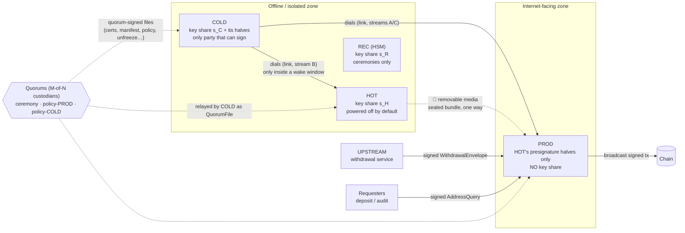

*Nobody dials COLD or HOT. HOT and PROD have no link. PROD accepts only COLD's link.*

### 2. Lifecycle

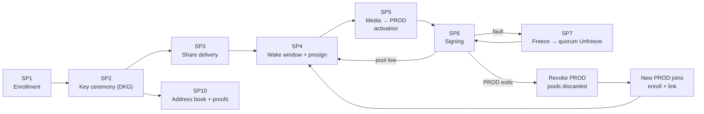

### 3. SP1 · Enrollment and links: every byte is authenticated before it is parsed

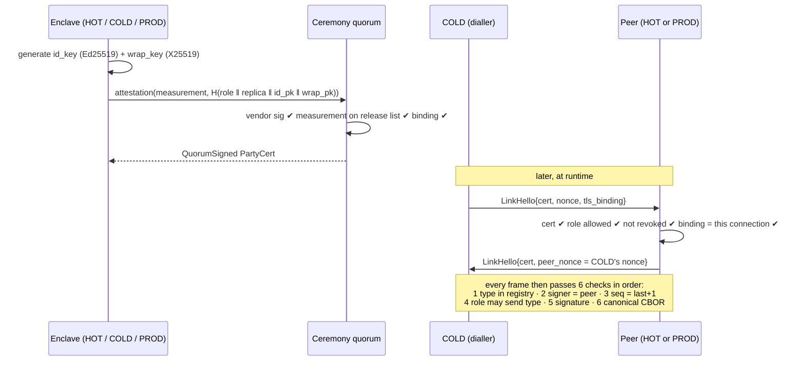

### 4. SP2 + SP3 · Making the key and delivering shares

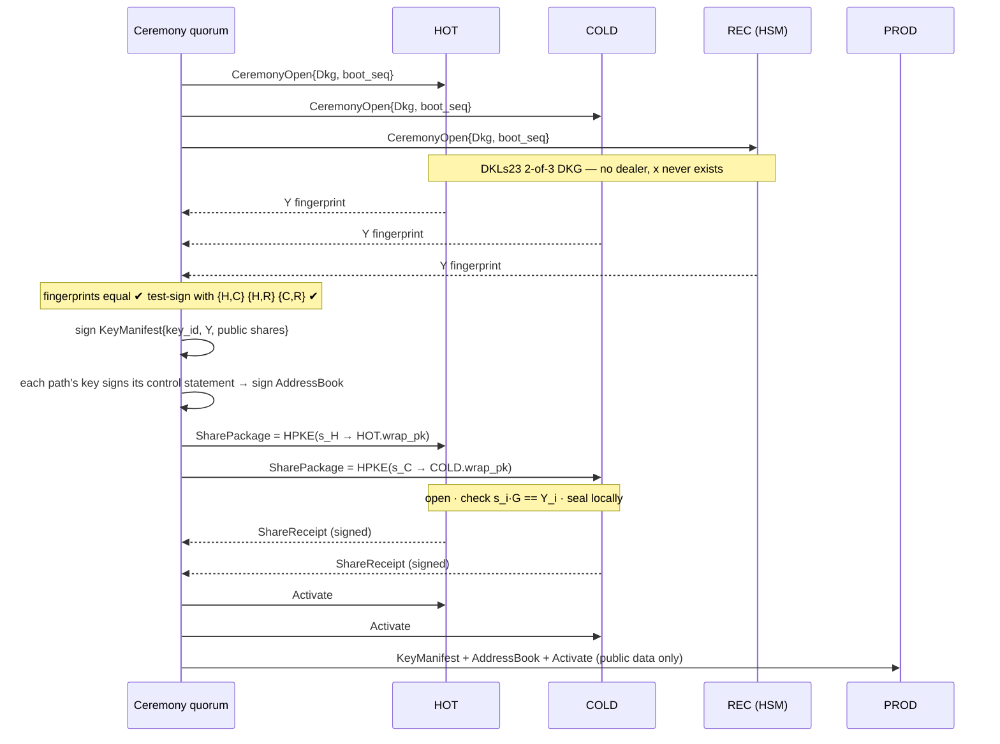

### 5. SP4 · Wake window: HOT wakes only when two operators agree

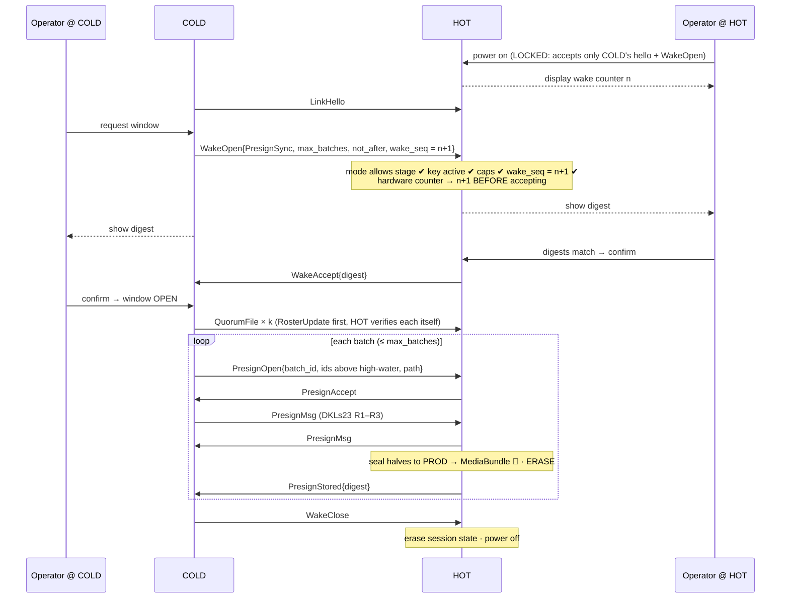

### 6. SP5 · Media transfer and three-digest activation

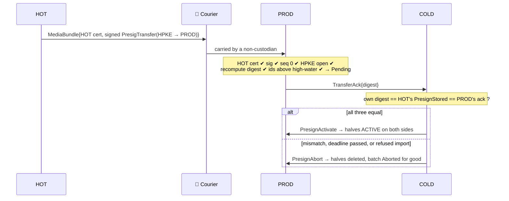

### 7. SP6 · Signing: one message PROD → COLD

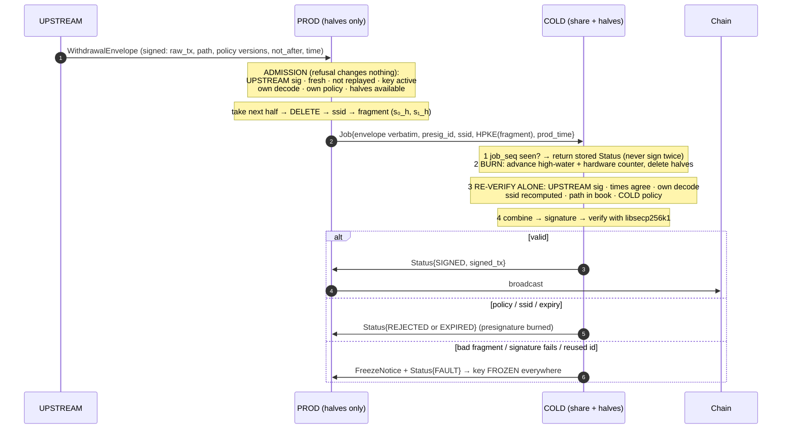

### 8. SP7 · Attack, freeze and recovery

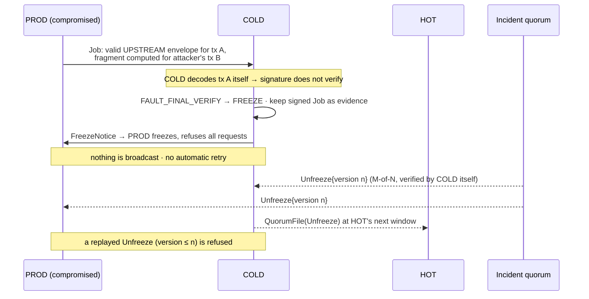

### 9. §6.1 · Restarts and storage restore: a presignature is never used twice

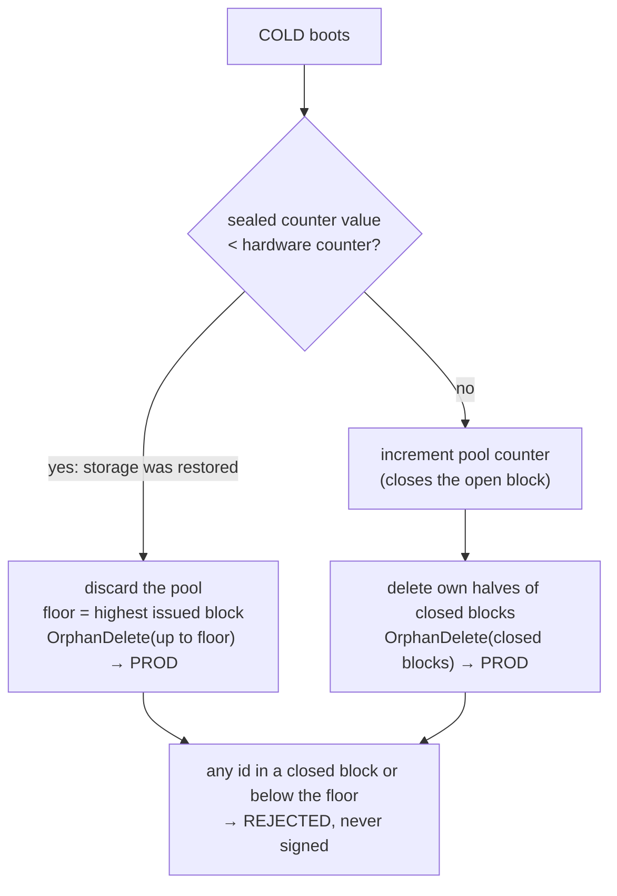

### 10. Exit and join: replacing PROD needs no key ceremony

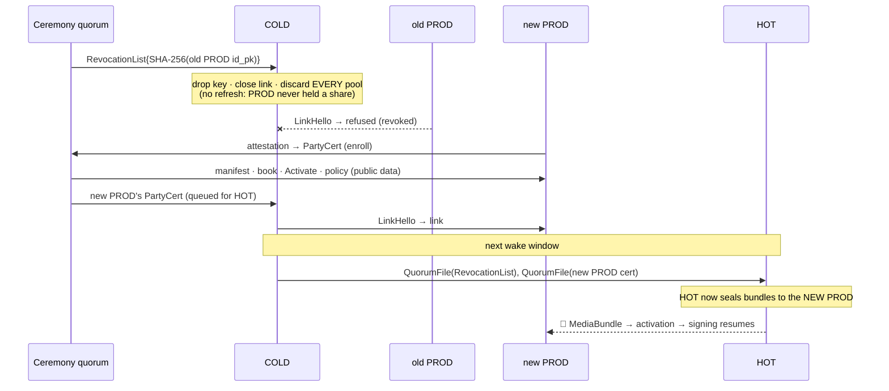

*A share holder (HOT, COLD or REC) leaving is different: CHP never repairs it. The two survivors
sweep the funds to a pre-registered cold wallet in an offline ceremony, and a new key is made
from scratch (DESIGN SP8 §4).*

### 11. SP10 · Address proofs: no trust in PROD

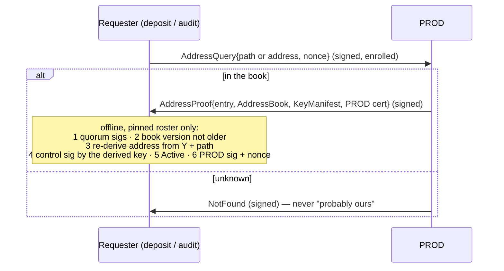

## Performance

Measured on **reference hardware**, release build, simulated TEE, in-memory transport (no network).
Full table, method and reading notes: [`docs/BENCHMARKS.md`](docs/BENCHMARKS.md).

| Operation | Median | p95 | DESIGN target |
|---|---:|---:|---|
| Withdrawal round trip, every check, no network | 0.79 ms | 1.53 ms | < 100 ms p99 incl. one hop |
| Presign, per presignature (batch of 64) | 3.5 ms | 3.6 ms | — |
| Whole key ceremony (enroll + DKG + test signatures + book + delivery) | 0.47 s | 0.53 s | — |

The online path costs well under a millisecond of compute per withdrawal; a deployment adds one
network hop PROD → COLD. Presign (offline, inside wake windows) is the expensive part.

## Documents

- [`docs/DESIGN.md`](docs/DESIGN.md) — the protocol design.
- [`docs/PLAN.md`](docs/PLAN.md) — implementation plan: scope, workspace layout, phases, testing.
- [`docs/design-notes.md`](docs/design-notes.md) — findings and proposed design changes from building it.
- [`docs/SECURITY.md`](docs/SECURITY.md) — security review: findings, fixes, regression tests, open items.
- [`docs/BENCHMARKS.md`](docs/BENCHMARKS.md) — timings on reference hardware.
- [`crates/chp-frost/REVIEW.md`](crates/chp-frost/REVIEW.md) — FROST / Taproot validation report.

## Layout

Rust workspace (see [`docs/PLAN.md`](docs/PLAN.md)):

| Crate | Purpose |
|---|---|
| `chp-wire` | closed message registry, deterministic CBOR, signed frames |
| `chp-auth` | SP1: certificates, authorization matrix, 6-step frame check, quorum, revocation |
| `chp-crypto` | hashing, `t_path`, HPKE, identity keys, ECDSA fragment/completion, independent verifier (no MPC code) |
| `chp-mpc` | adapter over the vendored DKLs23 library: DKG, presign, refresh (never linked by PROD) |
| `chp-frost` | FROST δ-masked split signing, Taproot sign factors, BIP340/86/341 vectors |
| `chp-tee` | simulated TEE/HSM: keys, attestation, hardware monotonic counters |
| `chp-core` | shared engine pieces: digests, keyring, address book and proof verifier |
| `chp-chain`, `chp-policy` | EIP-1559 decoder; reference policy with per-party ledger |
| `chp-engine-hot`, `chp-engine-cold`, `chp-engine-prod` | one engine per role |
| `chp-ceremony` | enrollment, DKG ceremony, share packages, address book, REC |
| `chp-sim` | in-process simulator and end-to-end / adversarial tests |
| `thirdparty/dkls23` | vendored Silence Laboratories DKLs23 (third-party, own non-commercial license, see `THIRD_PARTY_LICENSES.md`) |

## Running

```sh
./scripts/web-demo.sh                 # animated web demo of a real run → http://127.0.0.1:14080
cargo run -p chp-sim --example demo   # narrated run of every flow above, every message printed
cargo run --release -p chp-sim --example bench   # timings (see docs/BENCHMARKS.md)
cargo test --workspace                # 111 tests: crypto validation, SP1, engines, end-to-end, adversarial, security regressions
./scripts/check-capabilities.sh       # PROD has no MPC code path; no simulation hooks in production builds
```

## Status

Phases 0–6 of the plan are implemented: SP1–SP7 and SP10 for ECDSA/EVM run end to end in the
simulator, including compromised-PROD, storage-restore and media-failure scenarios. FROST
cryptography is validated but not yet wired into the engines; SP8 ceremonies and SP9 QR are not
built yet. Findings about the design: [`docs/design-notes.md`](docs/design-notes.md).

## Licensing

The code of this repository is MIT-licensed ([`LICENSE`](LICENSE)). Third-party components keep
their own licenses: `thirdparty/dkls23` is under the Silence Laboratories **Non-Commercial**
License. Commercial use of it is the user's own responsibility. See
[`THIRD_PARTY_LICENSES.md`](THIRD_PARTY_LICENSES.md) and [`NOTICE`](NOTICE).

## Security

An internal security review (three independent reviewers plus `cargo audit`) found 2 high, 10
medium and 14 low issues. All 26 are fixed, each with a regression test where practical; a few
items are accepted as open for the prototype. A compromised PROD could not get an unauthorised
signature, reuse a presignature or extract COLD's secrets. See [`docs/SECURITY.md`](docs/SECURITY.md).

## Warnings

Several constructions in the design are marked **REVIEW REQUIRED** (FROST δ masking, Taproot sign
factors, CHP path derivation). They are implemented here for evaluation only and need independent
cryptographic review before any use.
