# Design: a true multiple point of failure for hot wallets

## 1. The problem

A hot wallet is, by default, a **single point of failure**. Two failures are enough:

- an attacker who **obtains the secret**, or
- an attacker who can **call the hot wallet's API directly**,

and every asset the wallet controls is gone. Hot-wallet breaches of exactly this kind have cost the industry **billions**.

So a hot wallet needs **multiple points of failure**: an attacker must defeat several independent things, not one. Splitting the key is not enough on its own. A *true* multiple point of failure has to answer five questions.

## 2. The five questions

| # | Question | It is a single point of failure if… | Requirement |
|---|---|---|---|
| 1 | **Key shares** | one key is stored in one place | two or more key shares, held in different places; no full key anywhere, ever |
| 2 | **Isolation systems** | everything runs in one cloud, one account, one network | two or more isolated systems: separate providers, accounts, networks, hardware |
| 3 | **Policy checks** | transactions are checked in one centralised system, or every checker relies on the same policy source or oracle | two or more independent policy checks, each able to refuse on its own, **fed by two or more independent policy sources** (rules and data: allowlists, limits, prices, risk scores, chain state, time) |
| 4 | **Human roles** | one person or team can touch the system physically, remotely, or through CI/CD, or controls every policy source | two or more separated roles across development, management, operations and IT, **including separate teams for each policy source and oracle** |
| 5 | **Codebase & supply chain** | there is one codebase and one supply chain | two or more codebases or build/supply chains, so one compromise cannot reach every party |

**TSS / MPC answers question 1.** A true multiple point of failure needs more than that.

## 3. What this design covers

This design proposes a protocol suite, the **COLD-HOT-PROD protocol (CHP)**, built on TSS/MPC (DKLs23 for ECDSA, FROST for Schnorr/EdDSA).

- **The protocol answers questions 1–3.**
- **Questions 4 and 5 are the deployer's responsibility.** The protocol is designed so a deployer *can* answer them (section 5).

### Question 1 · Key shares

- **2-of-3 threshold key** over three share holders: **COLD**, **HOT** and REC (an offline backup HSM). The key is produced by distributed key generation, with no trusted dealer, so **the full private key never exists**.
- **PROD, the only online party, holds no key share**, only HOT's one-time presignature halves. Breaching PROD alone is not a key compromise: revoke it and discard the pools. Exception, for every protocol: if COLD may also have been compromised before the pools were discarded, PROD's and COLD's halves together expose the key (DKLs23) or HOT's share (FROST), so treat it as a share-holder compromise and sweep (SP8 §4).
- **Take = delete:** presignature halves are destroyed as they are used or moved, and their ids are never reissued.
- **Refresh** re-randomises every share on a schedule, so a stolen share goes stale once the deployer destroys the old shares (the protocol itself never deletes a share; section 7).

### Question 2 · Isolation systems

| Party | Zone | Holds | Network |
|---|---|---|---|
| **COLD** | offline (QR route) / pull-only (linked route) | key share and its presignature halves; signs (PROD broadcasts) | QR route: no network path to PROD, only the isolated link to HOT; jobs and signatures cross by QR code. Linked route: no inbound connections; COLD only pulls, dialing HOT and PROD over private links |
| **HOT** | offline, **powered off by default** | key share; presigns with COLD inside an agreed wake window | no inbound connections except COLD's link while awake, and the isolated ceremony network in ceremony mode; **no network path to PROD** |
| **PROD** | online | HOT's presignature halves only | the only internet-facing party; its only party link is the one COLD opens (none on the QR route); reaches chain nodes and its own policy sources (read-only) and broadcasts; opens no link to a CHP party |
| REC | offline backup | third key share in an HSM | none; ceremonies only |

- **HOT → PROD is removable media only.** HOT seals presignature halves into a bundle that only PROD can open, an operator carries it, and PROD imports it. There is no link to attack.
- **Each party runs in its own TEE/HSM, with its own identity and encryption keys.** It is meant to run on a separate provider, account and network. Each is enrolled separately with a quorum-signed certificate bound to its attested enclave.
- **The transport is never trusted.** Every message is signed by an enclave key, sequence-numbered and authorised by role. A compromised host or network can delay or drop messages, nothing more.

### Question 3 · Policy checks

- **Two independent checkers on every withdrawal:**
  - **PROD** checks the request against its own limits before it uses any presignature.
  - **COLD** then re-verifies everything **on its own**: the upstream signature, its **own decode** of the transaction, a recomputed session id, and its own policy and ledger. Any human approval is a deployer choice made before UPSTREAM signs the request; it is outside the protocol.
- **Independent policy sources, not only independent checkers.** Two checkers that read the same allowlist, price feed, risk score or chain view fail together when that one source is poisoned. Each checker takes its rules and data from its own source or oracle (for example a different price feed, a different chain node provider, a separately maintained allowlist), so one compromised source can mislead at most one checker.
- **No central policy database.** Each party keeps its own limits and ledger. Policy changes arrive as versioned, quorum-signed bundles that each party verifies itself.
- **Only COLD can produce a signature**, and only for a transaction that passed both checks. A compromised PROD cannot swap the request, reuse a presignature or slip in a bad contribution without freezing the key.

### Beyond the three questions · Role separation confines capability

Splitting HOT's work between **HOT** (offline) and **PROD** (online) does two more things.

**1. It minimises where important keys can leak.** The online machine holds the least possible:

| Secret | Where it lives | On PROD? |
|---|---|---|
| Key shares | COLD, HOT (offline), REC (offline HSM) | **never** |
| Quorum keys (unfreeze, revoke, policy, ceremonies) | offline custodians | **never** |
| Presignature halves | COLD, PROD | yes: per-use, deleted when used, useless alone; **key-equivalent together with COLD's matching halves** (section 6) |
| FROST `δ` / `s′_h` | COLD / PROD | `s′_h` only: one-time; with COLD's matching `δ` it reveals HOT's long-term share ⚠ |
| PROD's own identity and HPKE keys | PROD's enclave | yes: revocable without touching the key |

**2. It constrains what each party can do, by protocol rather than by configuration.**

A live, API-reachable party must never be able to move from *signing* into *key management*, whether automatically or because a peer asked it to. That move is the loophole behind real key-extraction attacks:

- **TSSHOCK** exploited weak Fiat–Shamir in threshold-ECDSA proofs: ambiguous hash encodings and too few challenge rounds. A malicious peer forged proofs in protocol runs the victim could be made to execute, and extracted the victim's share.
- **BitForge** planted a malicious Paillier modulus during key generation or refresh, without the proofs that should have rejected it, then extracted the key through ordinary signing.

Both need the victim to (re-)run key generation, refresh, resharing, auxiliary setup, or proof-carrying protocol rounds with an attacker-chosen peer.

In CHP that path does not exist:

| Party | Allowed to do at runtime | Cannot do (no code path, no message type, refused if attempted) |
|---|---|---|
| **PROD** (online) | import a media bundle; check a request; send one fragment (`Job`); `PoolStatus`, `TransferAck`, `PresignAbort`, `FreezeNotice`; answer `AddressQuery` with a signed `AddressProof` or `NotFound` | hold a share; take part in presign; DKG, refresh, reshare, aux setup; accept a `SharePackage` (any key material); sign anything on its own |
| **HOT** (offline) | accept a wake window (`WakeAccept`); apply relayed quorum files (`QuorumFile`); answer COLD's presign sessions inside it; export sealed halves; join a quorum-opened ceremony (`CeremonyOpen`) | receive requests; send jobs; talk to PROD over a network; start any key operation |
| **COLD** (offline) | open wake windows; drive presign; check and sign jobs; activate or abort batches | accept key material or a new key version over its runtime links |
| Key generation and refresh | **only** in a quorum-opened ceremony on the isolated network, with cross-attestation ([SP2](#sp2), [SP8](#sp8)) | — |

**Three independent layers of control.** Each layer alone stops PROD from turning signing into key management, and an attacker has to defeat all three:

| Layer | Control | What it stops |
|---|---|---|
| **1. Network** | **COLD dials; nobody dials COLD or HOT.** Among CHP parties, PROD accepts only COLD's link and opens no link; UPSTREAM and address-proof requesters reach it only through its authenticated API, and it reaches only chain nodes and its own policy sources (read-only), and broadcasts. HOT is reachable only through COLD's link, and HOT → PROD is one-way removable media | PROD can't reach HOT (the share holder) at all, and can't open a session with anyone. A compromised PROD can only answer COLD |
| **2. Role authorization** | Every frame is checked against the sender's **role** before it is parsed: a closed registry, the `may_send` table, and engines with no capability beyond their role | Even over a valid link with valid keys, PROD can't send presign, key-delivery or ceremony messages, and HOT can't send jobs |
| **3. Stage progression** | Stages move **forward only**, and **no single party can advance a stage that grants capability**. Any party can stop things alone | PROD can't activate halves, unfreeze, start a new key version, or sign by itself |

How layer 3 plays out for each stage:

| Stage change | Needs |
|---|---|
| Batch exported | HOT's signed `PresignStored` (COLD can't declare it) |
| Batch active on COLD | COLD's own halves **+** HOT's export digest **+** PROD's import digest, all equal |
| Batch active on PROD | PROD's verified import **+** COLD-signed `PresignActivate` with the same digest |
| Signature | PROD's fragment **+** COLD's contribution, after both policy checks |
| Unfreeze, revocation, policy version | M-of-N quorum, verified by each party itself, with a monotonic version |
| New key (DKG, new `key_id`) or new key version (refresh, same key) | quorum-opened offline ceremony with all three share holders (DKG and refresh change every share), then quorum `Activate` |
| New address (control signature) | quorum-opened offline ceremony with any two share holders (a 2-of-3 signature), then a quorum-signed `AddressBook` version |
| **Towards safety:** abort a batch, freeze a key | **any one party, alone**: COLD aborts or freezes; PROD refuses an import (abort) or freezes on a notice; HOT or COLD freezes on a presign fault. Aborts are final; a freeze lasts until a quorum `Unfreeze` |

In addition:

- **A closed message registry and a role table.** Key-management messages (DKG and refresh rounds, `SharePackage`) do not exist on runtime links. Public, quorum-signed control objects (`KeyManifest`, `Activate`, `Retire`, `AddressBook`, `Unfreeze`, …) are not key-management messages and may be relayed, because each recipient verifies the quorum signature itself. Every frame whose type is unknown, or not allowed for the sender's role, is refused before it is parsed ([SP1](#sp1)).
- **Engines without the capability.** The PROD engine has no presign, keygen or refresh entry points, and refuses to be configured with a key share. At runtime its control interface accepts only public, quorum-signed control objects (`Unfreeze`, `RevocationList`, `PolicyBundle`, `AddressBook`, `QrPairing`, `RosterUpdate`, `PartyCert` for UPSTREAM, requesters and a new COLD replica, and for a new key or key version `KeyManifest`, `Activate` and `Retire`; COLD accepts the same public objects, including UPSTREAM's `PartyCert`); it refuses any `SharePackage` even when quorum-signed.
- **No weakenable proofs on the live path.** DKLs23 uses OT-based multiplication, not Paillier, so there is no modulus to plant. Presign runs only between the offline parties. Online signing carries no zero-knowledge proofs at all: PROD sends one fragment per input (two scalars for DKLs23, one for FROST), and COLD verifies the final signature. Every encoding is canonical, length-prefixed and domain-separated.
- **One-way transitions.** Key versions change only through a ceremony (`Activate`, then `Retire`). Batches only move forward. A failed check freezes the key with **no automatic retry**, so an attacker cannot farm repeated aborts.

## 4. The COLD-HOT-PROD protocol suite

<a id="overview"></a>
### Overview
CHP is **ten sub-protocols** sharing one identity model and one message format. Each has its own section below: [SP1](#sp1) to [SP10](#sp10).

#### Parties

| Party | Holds | Network |
|---|---|---|
| **COLD** | Key share, its presignature halves, FROST `δ` values | Offline (QR route) or pull-only (linked route): dials HOT and PROD; accepts nothing inbound |
| **HOT** | HOT's key share | Secure zone, powered off by default. Its only runtime link is the one COLD opens in a wake window; ceremonies use the isolated ceremony network. **No link to PROD** |
| **PROD** | HOT's presignature halves only (FROST: one-time `s′_h` ⚠) | Internet-facing. Its only link is the one COLD opens |
| **REC** | Third key share | Offline HSM. Ceremonies only |
| UPSTREAM | Request-signing key | Sends withdrawal requests and address queries to PROD |
| Requesters | Enrolled certificate | Deposit or audit services; send address queries to PROD (SP10) |
| Ceremony quorum (M-of-N) | Quorum keys | Offline. Signs certificates, manifests, packages, address books, control messages |
| Policy quorum (M-of-N) | Quorum keys | Offline. Signs each party's `PolicyBundle` |

#### Lifecycle

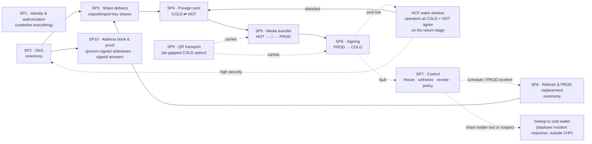

#### Sub-protocols

| # | Sub-protocol | Parties | Channel | When |
|---|---|---|---|---|
| [SP1](#sp1) | **Identity & authorization**: enrollment, certificates, link handshake, framing, who may send what, quorum control, revocation | all | ceremony · links · media | always |
| [SP2](#sp2) | **DKG**: 2-of-3 key generation, key manifest, test signatures | HOT · COLD · REC + quorum | isolated ceremony network | once per key |
| [SP3](#sp3) | **Share delivery**: export key shares from the ceremony, import into HOT / COLD, receipts, activation | ceremony → HOT, COLD; PROD gets public data only | removable media | after SP2 / SP8 |
| [SP4](#sp4) | **Presign sync**: batches of presignatures | COLD ⇄ HOT | link (stream B) | inside a wake window opened by operators at both COLD and HOT |
| [SP5](#sp5) | **Media transfer**: HOT exports sealed halves, PROD imports, COLD activates; forward-only batches and aborts | HOT → PROD → COLD | 💾 media, then link (stream C) | after every batch |
| [SP6](#sp6) | **Signing**: one fragment PROD → COLD, COLD signs, PROD broadcasts | UPSTREAM → PROD → COLD | links (streams A, C) | per withdrawal |
| [SP7](#sp7) | **Control**: freeze notices, quorum unfreeze, revocation, policy bundles, pool reconciliation | all + quorum | links · quorum-signed files | on events |
| [SP8](#sp8) | **Refresh & PROD replacement**: proactive refresh; replacing PROD; guidelines for sweeping after a share-holder loss | HOT · COLD · REC + quorum; PROD (public data, replacement) | ceremony network | schedule / PROD incident |
| [SP9](#sp9) | **QR transport**: air-gapped COLD; SP5 activation and SP6 signing over QR codes | PROD ⇄ COLD | display → camera, operator-carried | per job, when the deployer chooses the QR route |
| [SP10](#sp10) | **Address book & proof**: quorum-signed addresses derived from the ceremony key; PROD answers signed address proofs | ceremony quorum → all; UPSTREAM and requesters ⇄ PROD | ceremony · media · PROD's API | at DKG / new key version; on request |

#### Rules every sub-protocol obeys

1. **Authenticated before parsed.** Every message is a `SignedMsg` (one enclave key) or a `QuorumSignedMsg` (M-of-N). The receiver runs the checks of SP1 §5, in that order, before parsing the body ([SP1](#sp1)).
2. **Forward-only state.** Batches, steps and key versions only move forward. Terminal states (`Active`, `Aborted`, `Retired`) are final. A rollback is refused by monotonic versions, sequence numbers and the store's high-water mark.
3. **Take = delete.** Secret per-use material (presignature halves, `δ`, `s′_h`) is deleted as it is used or moved. It is never copied and never comes back.
4. **No party holds two shares**, and no share or half exists in plaintext outside its owner's TEE or HSM. Shares move only as HPKE ciphertext to an attested key.
5. **Two parties are always needed.** Every sub-protocol keeps the 2-of-3 threshold. HOT and PROD together are still only one share holder (HOT).
6. **No live path into key management.** Only offline, quorum-opened ceremonies run key generation or refresh (SP2, SP8). CHP has no resharing or repair; a sweep after a share-holder loss is a deployer procedure outside CHP (SP8 §4). PROD can never switch from signing to dealing or refreshing keys, and no runtime link carries key-management messages. This closes the TSSHOCK / BitForge loophole (section 3).
7. **Three layers of control, each sufficient alone.** (1) Network: COLD dials; nobody dials COLD or HOT; among CHP parties PROD accepts only COLD's link and opens none; UPSTREAM and requesters reach it only through its authenticated API; it reaches only chain nodes and its own policy sources (read-only), and broadcasts. (2) Role authorization on every frame. (3) Stage progression: no single party can advance a stage that grants capability (activate, unfreeze, new key version, sign); any one party can move towards safety alone (abort, freeze).
8. **The protocol never deletes a key share (top priority).** Its only destructive actions are **deleting presignature material** (halves, `δ`, `s′_h`, wake-session state), which costs presignatures and never access to funds, and **freezing** a key, which is reversible by a quorum `Unfreeze`. Retiring a key version, revoking a party or retiring an address makes material *unusable* in the engines; it deletes nothing. Physically destroying a share (an old version after refresh, a ceremony instance, a retired key) is a **deployer operation outside CHP**, with guidelines in section 7. Every side effect of the protocol is listed there.

---

<a id="sp1"></a>
### SP1 · Identity & authorization

#### 1. Purpose

Every party must be able to answer three questions about every byte it receives, with **no trust in the network or the transport**:

1. *Who sent this?* A specific enclave key or HSM key, or an M-of-N quorum.
2. *Is that sender allowed to send this kind of message to me?*
3. *Is this fresh, and in order?*

The answers are anchored in a small set of roots compiled into each enclave image.

#### 2. Trust roots

| Root | Held by | Authorises |
|---|---|---|
| Ceremony quorum (M-of-N Ed25519) | separate custodians, offline | party certificates, key manifests, share packages, `Activate`, `Unfreeze`, `RevocationList`, `Retire`, `AddressBook`, `QrPairing`, `CeremonyOpen` |
| Current roster of each quorum role | that role's custodians | `RosterUpdate` for that role (only with quorum separation) |
| Policy quorum (M-of-N) | risk / ops admins | `PolicyBundle` |
| Release keys | build pipelines | allowed enclave measurements |
| UPSTREAM and requester keys (certified by the ceremony quorum) | withdrawal service HSM; deployer-enrolled deposit / audit services | `WithdrawalEnvelope` (UPSTREAM only), `AddressQuery` |

**Quorum separation (best practice, where the organization can afford it).** The minimum is the single ceremony quorum above. That quorum is powerful (enrollment, activation, unfreeze, revocation) and its roster is compiled into every image, so replacing a custodian needs a new release. Organizations that can manage more custodians should:

- **split the roster by function**: a ceremony quorum (enrollment, manifests, share packages, `Activate`, `Retire`, `AddressBook`, `QrPairing`, `CeremonyOpen`), an incident quorum (`Unfreeze`), a revocation quorum (`RevocationList`), and one policy quorum per policy source (`PolicyBundle` for PROD's source and for COLD's source), with no custodian holding keys in more than one where staffing allows;
- **allow roster rotation without a release**: a `RosterUpdate{role, version, members, threshold}` signed by the current roster for that role, with a monotonic version, verified by each party itself.

The trade-off is management cost: more custodians, more key ceremonies and more procedures to keep current. A smaller organization keeps one quorum and accepts that its compromise grants unfreeze, revocation and enrollment powers (but never a key share).

#### 3. Identity: enrollment → certificate

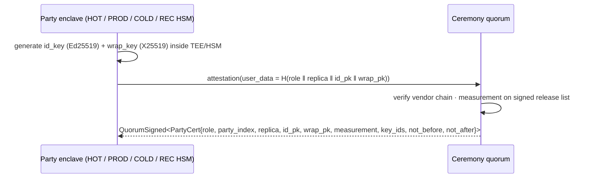

- **Roles:** `Hot` (HOT), `Prod`, `Cold`, `Rec`, `Upstream`, `Requester` (a deployer-enrolled system allowed to send `AddressQuery`, SP10), and the quorum roles: ceremony and policy, plus incident, revocation and per-source policy quorums when quorum separation is used.
- **Pinning:** a party is known to another only through a valid, unrevoked certificate. There is no public CA.
- Certificates are short-lived (e.g. 90 days). Renewal is a quorum signing over the same keys and moves no shares.

#### 4. Authenticated channels

| Channel | Who | How it is authenticated |
|---|---|---|
| **Link** COLD → HOT | COLD dials | mTLS 1.3 / QUIC, terminated inside the enclaves, plus the signed `LinkHello` exchange below |
| **Link** COLD → PROD | COLD dials | same |
| **Media** HOT → PROD | operator carries | no link: each `MediaBundle` carries HOT's quorum-signed certificate plus a signed transfer ([SP5](#sp5)) |
| **QR channel** PROD ⇄ COLD | operator carries (display → camera) | no link: every frame is signed and bound to a quorum-signed `QrPairing`, with persistent per-direction sequence numbers ([SP9](#sp9)) |
| **PROD API** UPSTREAM / requesters → PROD | caller connects | TLS, plus every message is a `SignedMsg` under the caller's enrolled certificate (`WithdrawalEnvelope`, `AddressQuery`). No stream sequence: replay is stopped by `request_id` (seen-before cache) or the query `nonce`, plus `not_after` |
| **Quorum files** | quorum → any party | `QuorumSignedMsg`, checked against the current roster (the roster in the image plus verified `RosterUpdate`s) |
| **Ceremony network** | DKG / refresh | cross-attestation, then signed protocol messages ([SP2](#sp2)) |

HOT and PROD **refuse each other's hellos**: there is no link between them.

##### Link handshake (`LinkHello`, seq 0)

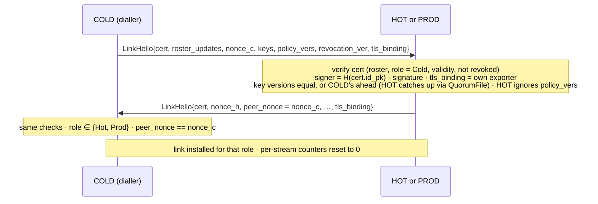

`roster_updates` carries any `RosterUpdate` chain the peer may not have yet; the receiver verifies and applies it before checking `cert`, so a roster rotation cannot lock a powered-off HOT out. `tls_binding` is the TLS exporter of this very connection, so a signed hello can't be replayed or relayed onto another connection.

#### 5. Framing: every message on a link

`SignedMsg { type, seq, body, signer, sig }`, where `sig = Ed25519(id_key, "chp-v1" ‖ type ‖ seq ‖ SHA-256(body))`.

A receiver checks, **before advancing any state**:

1. `type` is in the closed registry (the table below);
2. `signer` is the linked peer for that link, with a valid, unrevoked certificate;
3. `seq == last_seq + 1` on that stream (A: jobs, B: wake, presign and relayed quorum files, C: control) and in that direction;
4. the signer's role may send this `type` (the table below);
5. the signature;
6. the body decodes canonically: deterministic CBOR that re-encodes to the same bytes, so there are no unknown fields, trailing bytes or non-minimal integers.

Only then is `seq` advanced and the body handled. Replay, reordering, impersonation and type confusion all fail here.

#### 6. Authorization matrix

| Message | Sender | Receiver |
|---|---|---|
| `LinkHello` | COLD, HOT, PROD | peer on a link |
| `PresignOpen` | COLD only | HOT |
| `PresignActivate`, `Status` | COLD only | PROD |
| `PresignAccept`, `PresignRefuse`, `PresignStored`, `ShareMasks`, `PresigTransfer` | HOT only | COLD / PROD (via media) |
| `MediaBundle` | — (unsigned wrapper around HOT's certificate and its signed `PresigTransfer`; only the inner message is checked) | PROD |
| `PresignMsg`, `FrostCommitments` | COLD, HOT | each other |
| `TransferAck`, `PoolStatus`, `Job` | PROD only | COLD |
| `PresignAbort` | COLD, PROD | the others |
| `OrphanDelete` | COLD only | PROD |
| `FreezeNotice` | COLD, HOT, PROD | peer |
| `ShareReceipt` | HOT, COLD; REC in ceremonies only | quorum |
| `WithdrawalEnvelope` | UPSTREAM only | PROD, re-verified by COLD |
| `AddressQuery` | UPSTREAM or a deployer-enrolled requester (SP10 guideline) | PROD |
| `AddressProof`, `NotFound` | PROD only | the requester |
| `WakeOpen` | COLD only | HOT |
| `WakeAccept` | HOT only | COLD |
| `WakeClose` | COLD, HOT | each other |
| `QuorumFile` (wrapper around one `QuorumSignedMsg`; HOT verifies the inner message itself) | COLD only, on stream B | HOT |
| `CeremonyOpen` | ceremony quorum | the named participants (HOT, COLD, REC), on the ceremony network |
| Ceremony round messages (DKG and refresh rounds, address-sign signing rounds, `Y` fingerprints, test signatures, `ShareReceipt`) | HOT, COLD, REC named in the `CeremonyOpen` | each other and the quorum, on the ceremony network only |
| `PartyCert`, `KeyManifest`, `Activate`, `Unfreeze`, `RevocationList`, `Retire`, `QrPairing` | ceremony quorum | all |
| `SharePackage` | ceremony quorum | HOT, COLD only (ceremony or media; never on a runtime link) |
| `AddressBook` | ceremony quorum | all |
| `RosterUpdate` (only with quorum separation) | the current roster of that role | all parties, UPSTREAM and requesters |
| `PolicyBundle` | policy quorum | the party named in its `target` (PROD or COLD) only |
| *anything* | **REC** | **nothing at runtime** |

With quorum separation, `Unfreeze` comes from the incident quorum, `RevocationList` from the revocation quorum, and each party's `PolicyBundle` from the policy quorum of that party's source.

Anything not listed is refused, even with a valid signature. In particular: REC sends nothing, HOT can't send `Job` or `TransferAck`, PROD can't presign.

#### 7. Quorum-signed control and anti-rollback

`QuorumSignedMsg { type, body, sigs[] }` is valid when at least M distinct roster members signed the same domain-tagged digest. Non-members and duplicate signers are ignored.

Each control object carries a monotonic `version`. A party refuses any version at or below the last one it accepted, so an old `Unfreeze` or an old `RevocationList` cannot be replayed.

#### 8. Revocation

When a `RevocationList` names a party's `SHA-256(id_pk)`:

- that key is dropped from every keyring for good;
- any link to it is closed;
- if the revoked party is HOT, COLD or PROD, **every presignature pool is discarded**, because every pool involves its side (revoking REC, UPSTREAM, a requester or a quorum member discards no pool);
- the party can never link again.

Revoking PROD needs no key refresh, because it never held a share. Exception, for every protocol: if COLD may also have been compromised before the pools were discarded, treat it as a share-holder compromise and sweep ([SP8 §4](#sp8)).

#### 9. Security properties

- Network position grants nothing: authority comes only from signatures checked inside the enclave against pinned roots.
- A compromised transport or host can delay or drop frames, nothing more.
- A compromised party is limited to the message types its role may send.
- Every accepted frame is attributable to one enclave key, which serves as audit evidence.


---

<a id="sp2"></a>
### SP2 · Distributed key generation (key ceremony)

#### 1. Purpose

Create one **2-of-3** threshold key per chain or asset, so that:

- **the full private key never exists anywhere**, not even during generation (no trusted dealer);
- HOT, COLD and REC each end up with exactly one share;
- every party and the quorum agree on the group key and on each party's public share;
- the live systems never run key generation (no keygen attack surface in production).

#### 2. Parties and channel

| Party | In the ceremony as | Afterwards |
|---|---|---|
| **HOT** | a ceremony instance of HOT (or the production HOT enclave itself) | share goes to HOT ([SP3](#sp3)) |
| **COLD** | ceremony instance or production COLD | share goes to COLD |
| **REC** | its offline HSM | share stays in the HSM |
| **PROD** | **not a participant** | receives only public data (group key; FROST public shares) |
| Ceremony quorum | runs the ceremony, signs the outputs | — |

Channel: an **isolated ceremony network**, with no internet. Every participant first cross-attests the others' measurements ([SP1](#sp1)). Every DKG message is signed with the sender's identity key and carries the `ceremony_id`.

#### 3. Flow

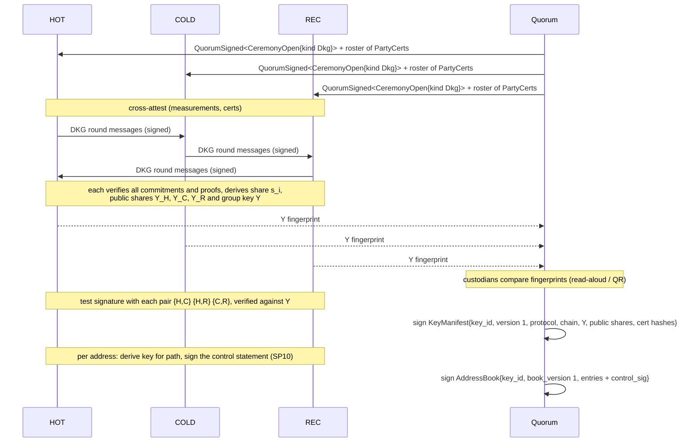

#### 4. Cryptography

##### ECDSA keys: DKLs23 key generation

- Parameters: threshold `t = 2`, `n = 3` parties, all with equal standing.
- Every party deals a random degree-1 polynomial with Feldman commitments. Every party verifies the shares it receives against those commitments and proves knowledge of its secret. The shares sum into `s_i`, with `Y = Σ` of the constant-term commitments.
- The key share also stores the **pairwise base-OT seeds** that later presign rounds use for the OT-based multiplication. That is why presigning needs no further setup ([SP4](#sp4)).
- No Paillier, so no Paillier-modulus proofs and no BitForge-class surface.

##### Schnorr keys: FROST DKG (Pedersen DKG)

1. **Round 1:** each party commits to a random polynomial (VSS commitment) and proves knowledge of its constant term (a Schnorr proof of knowledge bound to its identifier).
2. **Round 2:** each party sends every other party its secret share `f_i(j)`.
3. **Round 3:** each party verifies every received share against its sender's commitment, then derives `s_i`, the verifying shares `Y_j` and `Y`.

**Taproot** (BIP340-compatible FROST ciphersuite): DKG outputs the **untweaked** group key `Y`. The BIP86 tweak is applied **per derived key**, never at DKG: for each path, the derived internal key `P = Y + t_path·G` (SP6 §4 notation) gives the BIP86 output key `Q` (SP6 §4.2 defines the signs exactly). Addresses use `Q` ([SP10](#sp10)); signing applies the same per-path tweak (SP6 §4.2).

##### Agreement

Every party must output the same `Y` and the same public-share list. Any proof or VSS failure aborts the ceremony and names the faulty party. The manifest is signed only after the custodians have compared fingerprints and every pair's test signature has verified.

#### 5. Outputs

| Output | To |
|---|---|
| `KeyManifest` (quorum-signed): `key_id`, `key_version = 1`, protocol, chain, group key, `{party → public share, cert hash}`, `ceremony_id` | everyone, including PROD |
| `AddressBook` (quorum-signed): the key's addresses with control signatures ([SP10](#sp10)) | everyone, including PROD and UPSTREAM |
| HOT share | sealed for HOT ([SP3](#sp3)) |
| COLD share | sealed for COLD ([SP3](#sp3)) |
| REC share | stays in REC's HSM; encrypted backup per policy |
| Ceremony log + test signatures | audit |

Ceremony instances that are not the production enclaves keep their sealed packages; the protocol never zeroizes them. Zeroizing them is a deployer operation, recommended only after the recipient's `ShareReceipt` and the quorum `Activate` have arrived ([SP3](#sp3)), so a lost or corrupted delivery cannot destroy a share (rule 8).

#### 6. Security properties

- Up to one malicious party is tolerated (`t − 1`). The protocol either outputs a correct sharing or aborts with attribution.
- No party ever learns another party's share, and `x` is never assembled.
- Biased-key and inconsistent-share attacks are stopped by verifying the VSS commitments and by all-party agreement on `Y`.
- Production systems run no DKG code path at all.


---

<a id="sp3"></a>
### SP3 · Share delivery: export and import of key shares

#### 1. Purpose

Move each key share from the ceremony into the **one** production enclave that will hold it, with three guarantees:

- the share is never in plaintext outside hardware, including while it travels;
- only the intended enclave (by attested key) can open it;
- every recipient proves it holds the right share before the key goes live.

This protocol also gives PROD the **public** data it needs, without any share.

#### 2. Who receives what

| Recipient | Receives | Never receives |
|---|---|---|
| **HOT** | HOT's key share (`SharePackage`); the manifest; the `AddressBook` (to check presign paths); **PROD's certificate** (for sealing media bundles to it) | — |
| **COLD** | COLD's key share; the manifest; the `AddressBook` | — |
| **UPSTREAM** | the manifest and the `AddressBook` (to verify address proofs, SP10) | any key share |
| **PROD** | the manifest and the `AddressBook` only: group key, addresses, and for FROST the public key package with every public share | any key share |
| **REC** | nothing: its share never left its HSM | — |

#### 3. Flow

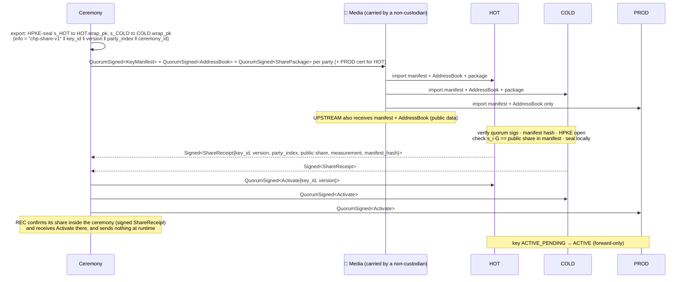

#### 4. Steps

1. **Export.** The ceremony quorum HPKE-seals each live share to the recipient's attested `wrap_pk`, taken from its quorum-signed `PartyCert`. The HPKE `info` binds the key, the version, the party and the ceremony, so a package can't be replayed against another key or party. The package and the manifest are quorum-signed.
2. **Carry.** The ciphertext travels on removable media, carried by someone who is not the recipient's custodian. The better option is for the production enclave itself to join the ceremony, so the share never leaves that hardware.
3. **Import.** HOT and COLD import share packages only in ceremony mode entered by a matching `CeremonyOpen` (a ceremony boot, or a `Dkg` wake window, SP4), never on a runtime link. The recipient enclave checks, in order:
   - the quorum signatures on the manifest and the package;
   - that `package.manifest_hash == H(manifest)` and that `party_index` is its own;
   - the HPKE open with its own `wrap_key` and the expected `info`;
   - **that its share matches its public share**: `s_i·G == Y_i` from the manifest (and the group key matches);
   - then it seals the share under its TEE/HSM key.

   The key is now `ACTIVE_PENDING`.
4. **Receipt.** The enclave returns a signed `ShareReceipt` naming the public share, its measurement and the manifest hash.
5. **Activate.** Only when every expected receipt has arrived does the quorum sign `Activate`. Parties move the key to `ACTIVE`, the go-live checks run, and presigning can start ([SP4](#sp4)).

PROD only verifies and stores the manifest, the `AddressBook` and `Activate`. For FROST it also keeps the public key package (public shares); the check of PROD's FROST fragment against `Y′_h` is done by COLD ([SP6 §4.2](#sp6)).

#### 5. Failure handling

| Failure | Result |
|---|---|
| Bad quorum signature, wrong manifest hash, wrong party | package rejected; nothing stored |
| HPKE fails to open (wrong recipient, tampered, wrong `info`) | rejected |
| `s_i·G ≠ Y_i` | rejected and reported; the ceremony must be re-run |
| A receipt is missing | no `Activate`; the key never goes live |
| A package is re-imported | ignored: version and manifest are already recorded (forward-only) |

#### 6. Security properties

- **Confidentiality in transit:** only the target enclave's attested key can open a package. The courier, media and hosts see ciphertext only.
- **Integrity and origin:** packages and manifests are quorum-signed, and receipts are enclave-signed.
- **Correctness:** each recipient proves `s_i` matches the agreed public share before activation.
- **Separation:** PROD is configured with public material only. PROD refuses any key share, and HOT refuses to be configured without its key share.


---

<a id="sp4"></a>
### SP4 · Presign sync: COLD ⇄ HOT

#### 1. Purpose

Do all the **message-independent** work of signing ahead of time, in batches, so that [SP6](#sp6) needs only one message. Each presignature has two halves:

- COLD keeps its half;
- HOT's half is sealed for PROD and leaves through [SP5](#sp5).

Only HOT (which holds HOT's key share) and COLD take part. PROD is not involved.

#### 2. Channel

The link COLD opens to HOT, stream B, which carries the wake messages (`WakeOpen`, `WakeAccept`, `WakeClose`) and then the presign rounds. Every frame is signed and sequence-numbered ([SP1](#sp1)).

HOT is **powered off by default**, so the link exists only inside a **wake window** that operators at both COLD and HOT have agreed to. Within a window COLD drives presigning, for example until PROD's reported pool is back above its refill target.

##### HOT power cycle and return stage

Waking HOT always needs **two operators, one at COLD and one at HOT** (different people), and both parties must agree on the stage HOT returns to. The deployer's mode fixes which return stage is allowed: *standard* allows `PresignSync` only; *high security* allows `Dkg` only, and a `Dkg` window continues into presign sync **for the newly activated key only**, in the same window. Every mode also allows `ControlOnly`: a window that only applies quorum files (below), allowed even while the key is frozen.

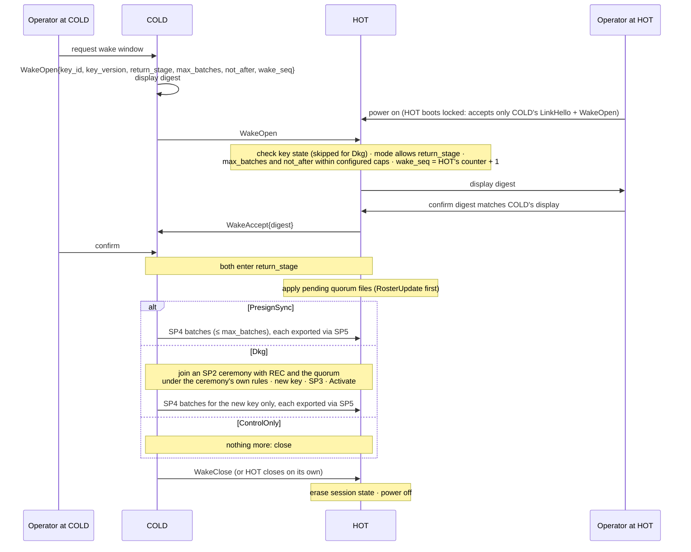

1. **Open (COLD).** COLD's operator requests a window. COLD builds `WakeOpen` (for `Dkg`, `key_id` is the new key's id and the key-state check is skipped) with the return stage, a batch cap, a deadline and the next `wake_seq`, and displays its digest.
2. **Boot locked (HOT).** HOT's operator powers HOT on. Until a window is agreed, HOT accepts only COLD's `LinkHello` and `WakeOpen`.
3. **Agree.** HOT checks the key state, that the deployer's mode allows the requested return stage, that the cap and deadline are within its configured limits, and that `wake_seq` equals its own **hardware-backed monotonic wake counter + 1** (exactly the next value; HOT shows its current counter at boot, so COLD and the quorum know it). HOT advances the counter by one before accepting, so a replayed `WakeOpen` is refused even if HOT's storage is restored while it is powered off. HOT displays the digest; its operator confirms it matches COLD's display; HOT sends `WakeAccept{digest}`; COLD's operator confirms. A mismatch in return stage or digest means the window never opens.
4. **Quorum files.** After `WakeAccept` and before any presign, HOT applies pending quorum files that COLD relays in `QuorumFile` wrappers (HOT verifies each inner quorum signature itself; COLD cannot alter them), `RosterUpdate` first so later files verify against the current roster (`RosterUpdate`, `Unfreeze`, `RevocationList`, `AddressBook`, new PROD `PartyCert`, `KeyManifest`, `Activate` / `Retire`). A `ControlOnly` window stops here.
5. **Run.** `PresignSync`: SP4 runs up to `max_batches`, and each batch leaves through SP5. `Dkg`: COLD and HOT go no further on their own; HOT switches to ceremony mode only on a matching `CeremonyOpen` (kind `Dkg`, with the new `key_id` that `WakeOpen` named, and `boot_seq[Hot]` = counter + 1, i.e. the value after the window's own increment), and they join the SP2 ceremony with REC and the quorum, which creates a **new key** (new `key_id`, new group key, new addresses); after SP3 and its `Activate`, the same window runs SP4 for the new key. The old key keeps signing until the new one is activated and the old one retired; the protocol deletes nothing of the old key (rule 8).
6. **Close.** The window ends at `max_batches`, at `not_after`, on any presign fault, or when either operator cancels. HOT sends or receives `WakeClose`, erases all session state and powers off. HOT also rate-limits presign sessions inside a window and freezes itself on any presign fault, without relying on COLD to report it.

**Ceremony boot (no COLD-opened wake window needed).** Refresh (SP8), address ceremonies (SP10) and DKG run on the ceremony network and do not need a wake window opened by COLD (COLD still takes part where the ceremony needs it). The quorum issues a `CeremonyOpen{ceremony_id, kind ∈ {Dkg, Refresh, AddressSign}, key_id, participants, not_after, boot_seq{Hot, Cold, Rec}}`, where `boot_seq` holds, for each participant, the next value of **that participant's own** boot counter; HOT's operator powers HOT on in ceremony mode on the isolated ceremony network, HOT verifies the quorum signatures, requires `boot_seq[Hot]` = its wake counter + 1 (the same counter as for wake windows) and advances it by one, its operator confirms the digest, and HOT then accepts only that ceremony's messages (including its v+1 `SharePackage` for a refresh). COLD and REC check `boot_seq[Cold]` and `boot_seq[Rec]` against their own hardware boot counters in the same way (COLD: a dedicated ceremony counter, separate from its pool counters; REC: an HSM counter object). After the ceremony HOT powers off. CHP engines refuse any other `kind`. A sweep after a share-holder loss (SP8 §4) is outside CHP and needs the deployer's own tooling; it does not use this boot mode.

**Signing keeps working throughout.** COLD continues to process SP6 jobs from the existing pool during a window: presign runs on stream B and never blocks stream A (or the [SP9](#sp9) QR channel).

#### 3. Flow

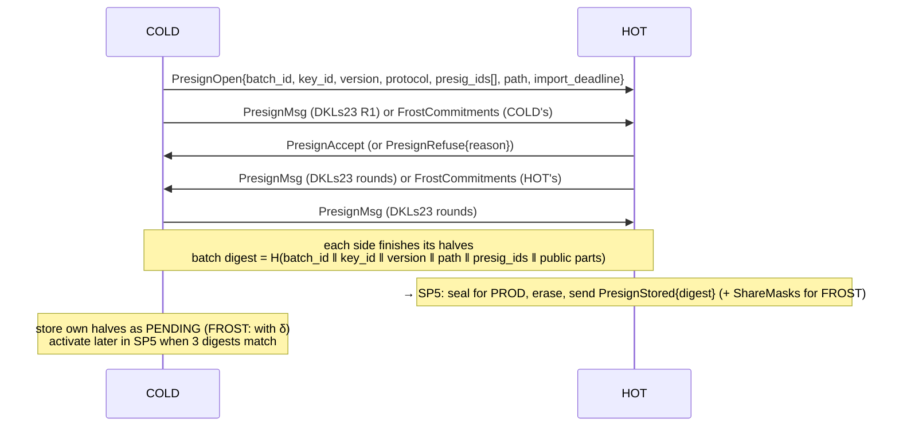

#### 4. Steps and checks

1. **Open (COLD).** A **pool** is one `(key_id, key_version, path)`; every pool has its own id sequence, its own high-water mark and its own hardware counter (section 6.1). COLD allocates `presig_id`s for the batch's pool strictly above that pool's high-water mark. Within a pool the id layout is `hot_replica ‖ cold_replica ‖ block ‖ index`, where `block` is the hardware-counter block (one block per batch). A fresh random `batch_id` is chosen, with at most 256 presignatures per batch. `import_deadline` is the latest time by which PROD's `TransferAck` must reach COLD; after it, COLD aborts the batch (SP5).
2. **Accept (HOT).** HOT refuses (`PresignRefuse`, which ends the batch) if any of these fail:
   - the key is active and not frozen;
   - `path` is an `Active` entry in the current address book ([SP10](#sp10));
   - version and protocol match;
   - the batch size is valid and the `batch_id` is unused;
   - the ids are strictly increasing compared with the last batch it accepted **for that pool**.
3. **Rounds.**
   - **DKLs23:** DKLs23 presign rounds R1–R3, one instance per presig id. The instance id is `H("chp-presign-v1" ‖ batch_id ‖ presig_id)`. Library messages are signed with the parties' identity keys, and the P2P rounds are encrypted. **All OT-multiplication consistency checks run in R3.**
   - **FROST:** each side generates fresh nonces `d`, `e` and their commitments `D`, `E`. The two sides exchange commitment lists, which must be complete, in order and valid group elements, and each side assembles its half.
4. **Digest.** Both sides compute `digest = SHA-256(batch_id ‖ key_id ‖ key_version ‖ path ‖ presig_ids ‖ public parts)` independently, with every field length-prefixed and the ids and public parts concatenated in id order. The public part of each presignature is the DKLs23 session id, or both FROST commitments.
5. **Hand-off.** HOT continues in [SP5](#sp5): it seals, erases, and sends `PresignStored{digest}` plus, for FROST, `ShareMasks`. COLD stores its halves as `PENDING` (for FROST, together with `δ`). Nothing is usable until SP5 activates it.

#### 5. Cryptography

##### DKLs23

- R1: each party commits to a nonce share `R_i = k_i·G`.
- R2: pairwise OT-based multiplication gives additive shares of `φ·k` and `φ·x`, using the base-OT seeds from [SP2](#sp2).
- R3: commitments are opened, `R = Σ R_i`, and the consistency checks verify the multiplication outputs against `R_i` and the public key shares.

The result per side is `(R, φ_i, s₀′_i, s₁_i)` with `Σs₁ = φk` and `Σs₀′ = rφx`. The math is in [SP6 §4.1](#sp6).

##### FROST

Two nonces per side per presignature. The binding factor in SP6 makes each nonce pair message-bound, which stops ROS/Drijvers-style concurrent attacks.

##### Derivation path binding (security trade-off)

Every presignature is bound to one derivation `path` at `PresignOpen`, and the path is part of the batch digest and of every `ssid`.

- **Why:** with ECDSA presignatures, `R` is known before the message. If the derivation tweak could still be chosen after `R` is known (additive HD derivation), an attacker who chooses messages could forge signatures (the Groth–Shoup attack). Fixing the path at presign time removes that choice.
- **What it costs:** one pool per path. Many addresses mean many small pools, more frequent refills and more presignatures stranded when a pool is discarded. Deployers should keep the hot wallet to a few addresses.
- **What it relies on:** COLD checks that each job's path equals the path its presignature was opened with (SP6 step 4); a mismatch is refused.
- **Alternatives, not used here:** re-randomizing presignatures at signing time (path-independent pools, but a construction that would need its own review), or hardened-only derivation (no additive tweak, but no watch-only address generation).

#### 6. Failure handling (forward-only)

| Failure | Result |
|---|---|
| `PresignRefuse` | batch ended at COLD; nothing stored |
| DKLs23 R3 consistency check fails / invalid FROST commitment | batch aborted, **key frozen** (`FreezeNotice`, `FAULT_PRESIGN`). **No automatic retry**, because repeated aborts can leak share bits |
| Link loss during rounds | batch aborted on both sides; COLD's pending halves deleted; ids never reused |
| Ids at or below the pool's high-water mark | the batch is refused (`PresignRefuse{ID_REUSED}`); not a fault |

#### 7. Security properties

- HOT's half never touches the network in the clear and leaves only as ciphertext to PROD ([SP5](#sp5)).
- Neither side ever sees the other's half.
- Presign runs only between the two parties of the signer set {HOT, COLD}. REC is not needed.
- A malicious party is detected in R3 (DKLs23) or at signing (FROST cheater detection), and the key freezes.


---

<a id="sp5"></a>
### SP5 · Media transfer: HOT → 💾 → PROD, then activation

#### 1. Purpose

Get HOT's presignature halves from HOT, which holds the key share in the secure zone, to PROD, which faces the internet, **with no network link between them**, and then activate the batch on both signing parties.

- Halves move by **export → removable media → import**.
- A batch only moves forward, or is aborted for good.

#### 2. Flow

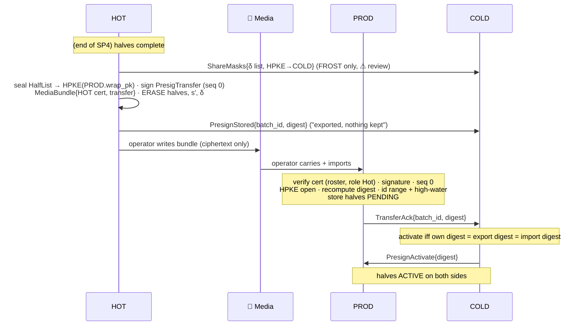

#### 3. Steps

1. **Split (FROST only, ⚠ REVIEW REQUIRED).** For each half, HOT computes `s′_h = s_h + δ` with a fresh `δ`. It sends COLD the `δ` values in `ShareMasks`, HPKE-sealed to COLD with `aad = batch_id`. Security notes and requirements: SP6 §4.2.
2. **Seal.** HOT builds `PresigTransfer{batch_id, key_id, version, path, presig_ids, import_deadline, digest, enc, ct}`:
   - the plaintext is `HalfList[StoredHalf{half, extra = s′_h}]`;
   - it is HPKE-sealed to PROD's `wrap_pk`, taken from PROD's quorum-signed certificate delivered in [SP3](#sp3);
   - `info = "chp-transfer-v1"`, `aad = H(transfer without ciphertext)`, which binds the digest into the ciphertext.

   HOT signs the transfer (seq 0) and wraps it with its own certificate in a `MediaBundle`.
3. **Erase and report.** HOT erases the halves, `s′_h` and `δ`, then sends COLD `PresignStored{digest}`.
4. **Export.** The operator writes the bundle to media. From here HOT holds nothing for the batch.
5. **Import (PROD).**
   - **Authenticate:** the certificate is valid under the roster, has role HOT, is within its validity window and is not revoked; the signer matches the certificate; seq = 0; the signature verifies. A bundle that fails here is rejected and **changes nothing**.
   - **Batch state:** if the batch is already `Pending` or `Active`, the bundle is a replay and is ignored, changing nothing. If the batch is `Aborted`, the import is refused.
   - **Content:** the key must be active and the version must match; the ids must be in this replica's range; the HPKE must open; PROD **recomputes the digest** from the decrypted halves; FROST halves must carry a split value; the store's high-water mark must accept the ids.
   - **Success:** halves stored `Pending`, and `TransferAck{digest}` sent to COLD.
   - **Refusal** of an authenticated bundle: the batch becomes `Aborted` and PROD sends `PresignAbort` to COLD.
6. **Activate (COLD).** COLD activates when all three hold:
   - its own halves are persisted (with `δ` for FROST);
   - HOT's `PresignStored` digest equals its own;
   - PROD's `TransferAck` digest equals its own.

   It then sends `PresignActivate` to PROD. HOT is not told: it holds nothing for the batch after export, whether it is still in the window or already powered off. A mismatch aborts the batch.

#### 4. Forward-only batch states

| Party | States |
|---|---|
| COLD | `Rounds → Exported → Imported → Active` (then no longer tracked) · any non-`Active` state → `Aborted` |
| HOT | in rounds → sealed and erased → (bundle written) |
| PROD | `Pending → Active` · `Pending → Aborted` · `Aborted` straight away (refused, or aborted before import) |

`Active` and `Aborted` are final. An active batch cannot be aborted; its halves end only by signing, `OrphanDelete` or pool discard.

#### 5. Aborts (`PresignAbort`)

| Who | When | Effect |
|---|---|---|
| COLD | media lost or late (`import_deadline` passed), operator decision, digest mismatch | COLD deletes its pending halves. HOT holds nothing after export (if still awake, it drops any bundle not yet written). PROD records `Aborted`, so a late bundle is refused |
| PROD | it refuses an authenticated bundle | COLD deletes its pending halves |
| COLD, on an ack for a batch it no longer waits for | — | tells PROD to abort it |
| Link loss (COLD ↔ PROD) | — | PROD aborts every `Pending` batch |
| PROD, at `import_deadline` (carried in `PresigTransfer`) | — | PROD aborts a batch still `Pending`; on the QR route this replaces link loss |

#### 6. Security properties

- **No link** HOT ↔ PROD. The bundle is ciphertext for PROD only; the courier and media see nothing useful.
- **Authenticity without a link:** the certificate travels with the bundle and is checked against the roster compiled into PROD's image.
- **Integrity:** the digest is bound into the HPKE AAD, PROD recomputes it, and COLD cross-checks three independent digests.
- **No reuse:** take = delete on HOT, store high-water marks on PROD and COLD, terminal `Aborted`.
- **Replay-safe:** a replayed bundle cannot touch a live batch, and a late bundle cannot revive an aborted one.

---

<a id="sp6"></a>
### SP6 · Online signing: PROD ⇄ COLD


#### 1. In one paragraph

The key is a 2-of-3 threshold key held by HOT, COLD and REC. The expensive, message-independent part of signing (presign) is done ahead of time, and HOT's halves reach PROD by removable media ([SP5](#sp5)). Signing a transaction then takes **one message from PROD to COLD**:

1. PROD checks the request, burns one presignature half per input, and sends its **fragment** (two scalars for DKLs23, one for FROST), encrypted to COLD.
2. COLD burns its own matching half, re-checks everything itself, combines the fragment with its own contribution, **verifies the final signature**, and returns the signed transaction for PROD to broadcast.

PROD never sees COLD's contribution; it receives only the finished signed transaction, to broadcast it. No other round trip is needed.

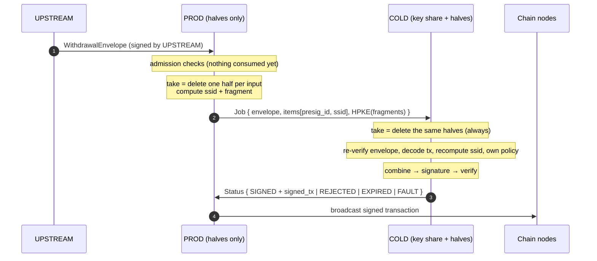

---

#### 2. What each side holds for one presignature

Both sides store their half under the same `presig_id`. The batch is `Active` on both: COLD activated it only after its own digest, HOT's export digest and PROD's import digest all matched.

| | PROD | COLD |
|---|---|---|
| **DKLs23 (ECDSA)** | `PreSign_h`: session id, `R`, `φ_h`, `s₀′_h`, `s₁_h`, group key `Y` | `PreSign_c`: same session id and `R`, `φ_c`, `s₀′_c`, `s₁_c`; its key share |
| **FROST (Schnorr / Ed25519)** | nonces `(d_h, e_h)`, both commitments `(D_h, E_h)` and `(D_c, E_c)`, the one-time share `s′_h = s_h + δ` ⚠ | nonces `(d_c, e_c)`, both commitments, its key share `s_c`, and `δ` |
| **Long-term key share** | **none** | `s_c` |

Neither side ever holds the other's half. Together the two halves of one DKLs23 presignature reveal the key, which is why halves only ever move HOT → PROD.

---

#### 3. The signing steps

##### Step 1. Request (UPSTREAM → PROD)

`WithdrawalEnvelope { request_id, key_id, chain, raw_tx, inputs, path, prod_policy_ver, cold_policy_ver, not_after }`, signed by UPSTREAM's key.

##### Step 2. Admission at PROD — no state changes

PROD refuses the request, **without using a presignature**, if any of these fail:

- the UPSTREAM signature verifies;
- the request has not expired, and its validity window is at most 300 s;
- `request_id` has not been seen before;
- the key is active and not frozen;
- the chain and PROD's own policy version (`prod_policy_ver`) match;
- PROD's **own decode** of `raw_tx` works, yielding one value `mᵢ` to sign per input;
- PROD's own independent policy validation passes ([SP7 §4](#sp7));
- there are enough active halves in the pool.

##### Step 3. Fragment at PROD

For each input `i`, PROD:

1. **takes the next half from the pool for this path, in strictly increasing `presig_id` order within that pool**, which deletes it from the store durably before anything is computed;
2. computes the session id `ssidᵢ = H(chain, key_id, key_version, presig_id, {HOT, COLD}, mᵢ, path)`;
3. computes its **fragment** for `mᵢ` (§4 below).

It then sends one `Job`:

```
Job { job_seq, envelope (forwarded verbatim), key_version,
      items: [ { input, presig_id, ssid } ],
      HPKE_to_COLD( fragments ) with aad = H(Job without ciphertext) }
```

The job is signed with PROD's identity key and carries a per-link sequence number. The fragments are readable only by COLD, and the AAD binds them to this exact job.

##### Step 4. Burn first, then re-check, at COLD

1. Verify the frame: it comes from the linked PROD, in sequence, and is a `Job`, which only PROD may send.
2. **Look up `job_seq` first.** If this `job_seq` was already handled, compare the job byte for byte: identical → return the stored `Status` (never signed twice); different → refuse. Only a new job continues.
3. **Advance the pool's high-water mark, then take every named half**, whatever happens next. Every pool `(key_id, key_version, path)` has its own high-water mark, rollback-protected by its own **hardware monotonic counter** (section 6.1); pools never affect each other. Per pool, the named ids must be increasing within the job and all above that pool's high-water mark. COLD first advances the mark to the highest named id, then deletes the named halves and any lower ones it still holds **in that pool only** (skipped ids are burned). An id in any block that pool's counter has passed (by a COLD restart or by normal advance into the next block), below a discarded pool's floor, or an issued id whose COLD half was already orphan-deleted or aborted, is **burned on both sides and the job is `REJECTED`**, not a fault: these are ordinary operations. Only an id at or below the pool's mark **inside the current open block**, or an id COLD never issued, is a `FAULT_PRESIG_STATE`: the key freezes.
4. Independently of PROD:
   - verify the UPSTREAM signature, the expiry and COLD's own replay cache;
   - check the key state and versions;
   - **decode `raw_tx` itself** and recompute every `mᵢ` and `ssidᵢ`;
   - check that the envelope's `path` equals the path each named presignature was opened with ([SP4](#sp4)), and that it is an `Active` entry in COLD's current address book ([SP10](#sp10)).

   A request past `not_after` → `EXPIRED`; any other mismatch → `REJECTED`. For example, an ssid mismatch means PROD and COLD disagree about what is being signed.
5. Apply COLD's own independent policy validation (see [SP7 §4](#sp7)): `APPROVE` or `REJECT`.

##### Step 5. Combine and verify at COLD

COLD opens the HPKE payload and, for each input, combines PROD's fragment with its own contribution (§4 below).

**COLD verifies every final signature against the derived key `Y_p` of the job's path** (§4) using a verifier implementation independent of the MPC library (strict verification for Ed25519). Any failure → `FAULT_PROD_FRAGMENT` (bad or undecryptable fragment) or `FAULT_FINAL_VERIFY`: the key freezes, COLD sends a `FreezeNotice`, and nothing is broadcast.

##### Step 6. Broadcast and status

COLD assembles the signed transaction and returns it in `Status { job_seq, request_id, outcome, txid, signed_tx }`. **PROD broadcasts it.** A signed transaction holds no secret, so COLD needs no chain connectivity in either route (linked or [SP9](#sp9) QR).

PROD verifies the Status signature, broadcasts, clears the job from its outbox, and on `SIGNED` counts the amount in its ledger.

---

#### 4. The MPC computation

Notation:

| Symbol | Meaning |
|---|---|
| `G` | generator |
| `q` | group order |
| `x` | group secret (never assembled anywhere) |
| `Y = x·G` | group key |
| `m` | the 32-byte prehash / sighash (ECDSA, Taproot) or the message (Ed25519) |
| `λ_h`, `λ_c` | Lagrange coefficients for the signer set {HOT, COLD} |
| `t_path` | the **public path tweak**, defined once for all of CHP: `t_path = H("chp-derive-v1" ‖ key_id ‖ Y ‖ path) mod q` (a tagged hash, length-prefixed inputs), `t_path = 0` for the root path. The derived key is `P = Y + t_path·G`. Every party and every SP10 verifier computes it the same way; no chain code is needed. (This is CHP's own derivation, not BIP32.) Ed25519 keys use only the root path (`t_path = 0`, one address entry per key) |
| `t`, `Y_p` | ECDSA and Ed25519: `t = t_path`, `Y_p = P`. Taproot: see §4.2 (`Y_p = Q`, with sign factors). Every final verification is against `Y_p`, never against `Y` unless the tweak is zero |

##### 4.1 ECDSA — DKLs23

Presign (COLD ⇄ HOT, offline from the signing path) gives the two parties additive shares such that, with a random mask `φ = φ_h + φ_c` and nonce `k`:

```
s₁_h + s₁_c = φ·k            R = k·G,  r = R.x mod q
s₀′_h + s₀′_c = r·φ·x
```

The OT-based multiplication and all its consistency checks run during presign. The online step has **no zero-knowledge proofs and no checks except the final verification**.

The path tweak enters as `m + r·t` in place of `m`: since `x_p = x + t`, `k⁻¹(m + r·x_p) = φ(m + r·t + r·x)/(φ·k)`. Both sides know `t` (public), so no extra round is needed.

**PROD's fragment** (96 bytes): `( sid, s₀_h = (m + r·t)·φ_h + s₀′_h, s₁_h )`.

**COLD's completion:**

```
s₀_c = (m + r·t)·φ_c + s₀′_c
s    = (s₀_h + s₀_c) / (s₁_h + s₁_c)  =  φ(m + r·(x + t)) / (φ·k)  =  k⁻¹(m + r·x_p)
```

COLD then normalises to low-s (`s > q/2 → q − s`, flipping the recovery bit), derives the recovery id from `R.y` parity and `R.x` overflow, and **verifies `(r, s)` against `Y_p`**, the derived key of the job's path.

Because the only online check is the final verification, a bad fragment shows up as a signature that fails to verify. With two parties, COLD's own half is computed locally, so the failure is attributed to PROD, and the signed `Job` is the evidence.

##### 4.2 Schnorr — FROST (RFC 9591), Taproot and Ed25519

Presign gave both sides each other's nonce commitments `D_j = d_j·G`, `E_j = e_j·G`.

**Signing key and sign factors.** Everything below is computed by both PROD and COLD from public data, so they always agree:

```
Ed25519:  Y_p = Y (root only),  g = 1,  t_eff = 0,  g_R = 1
Taproot:  P   = Y + t_path·G                      derived internal key
          g_P = +1 if P has even y, else −1       BIP340 lift of P
          t_tap = H_TapTweak((g_P·P).x)
          Q   = g_P·P + t_tap·G                    BIP86 output key (Y_p = Q)
          g_Q = +1 if Q has even y, else −1
          g     = g_Q·g_P                          sign on the shared secret x
          t_eff = g_Q·(g_P·t_path + t_tap)         public part of the signing key
```

so the Taproot signing key is `g·x + t_eff`, and `(g·x + t_eff)·G = g_Q·Q`, the even-y version of `Q`.

Both sides compute, for the commitment list `B`:

```
ρ_j = H₁(Y_p, m, B, j)              binding factor (stops ROS-style attacks)
R   = Σ_j (D_j + ρ_j·E_j)
g_R = +1 if R has even y, else −1    (Ed25519: g_R = 1)
c   = H₂(g_R·R, Y_p, m)              (BIP340 challenge over the x-coordinates for Taproot)
```

**PROD's fragment** (a signature share, signed for identifier HOT). PROD applies the signs to its own terms:

```
z_h = g_R·(d_h + e_h·ρ_h) + g·λ_h·s′_h·c          with s′_h = s_h + δ   ⚠
```

**COLD's completion:**

```
check  z_h·G == g_R·(D_h + ρ_h·E_h) + g·λ_h·c·Y′_h     (Y′_h = Y_h + δ·G)  → else FAULT_PROD_FRAGMENT
z_c  = g_R·(d_c + e_c·ρ_c) + g·λ_c·s′_c·c              (s′_c = s_c + (i_c/i_h)·δ)
z    = z_h + z_c + c·t_eff,     signature = (g_R·R, z)    (only COLD adds the public tweak, once)
```

Correctness: `λ_h·s′_h + λ_c·s′_c = λ_h·s_h + λ_c·s_c = x` (the δ terms cancel; applying the same `g` to both sides keeps that), so `z·G = g_R·R + c·(g·x + t_eff)·G`, which is the BIP340 equation for `Q` (Taproot) or the plain Schnorr equation for `Y_p` (Ed25519).

> ⚠ **REVIEW REQUIRED: Taproot signing math.** The sign factors (`g_P`, `g_Q`, `g`, `g_R`), the effective tweak `t_eff`, COLD's fragment check with signs, and their interaction with the `δ` masking are CHP's own construction. They are not taken from an existing library or paper. The algebra has been checked by hand, but it must get an independent cryptographic review and be tested against BIP340/BIP341 test vectors (including derived keys and nonces with odd y) before use. CHP's derivation `t_path` (§4 notation) needs the same review.

**Shares and `Y′_h` stay untweaked.** The path tweak and all sign factors are applied exactly as above, and only COLD adds `c·t_eff`. A library's built-in Taproot tweak (which adds the tweak to every signing share) must **not** also be used: it would count the tweak twice and break the `Y′_h` check.

- **Taproot:** the signature is the 64-byte BIP340 `(R.x, z)` over the BIP341 sighash, verified against `Q`.
- **Ed25519:** the signature is the 64-byte `(R, z)`, verified strictly.

> ⚠ The `δ` masking, which lets PROD sign without HOT's long-term share, is our own construction and is **REVIEW REQUIRED** (independent cryptographic review before use). Plain FROST would give PROD `s_h` itself.
>
> **What the split does and does not protect.** The algebra is a zero-sum masking of HOT's share between HOT and COLD (`λ_h·δ + λ_c·(i_c/i_h)·δ = 0`, where `i_h`, `i_c` are the FROST participant identifiers of HOT and COLD), so signatures are correct. PROD alone learns nothing about `s_h`: each `s′_h` uses a fresh `δ`, and differences between them reveal only differences of masks. But `s_h = s′_h − δ`, so **anyone holding one unused `s′_h` and its matching `δ` recovers HOT's long-term share**, and that share does **not** expire when the pool is discarded. (The DKLs23 case is the same in effect: PROD's and COLD's halves of one unused presignature give the key itself.) Consequences:
>
> - PROD + COLD compromised at the same time (before the pool is discarded) → HOT's share is exposed → treat it as a share-holder compromise and **sweep** ([SP8 §4](#sp8)), not just revoke PROD.
> - Discarding a FROST pool must delete COLD's `δ` values as well as PROD's halves; once either side's copy is gone, the stolen half is useless.
> - Requirements if the split is kept: a fresh `δ` per presignature, `δ` erased by COLD at use or discard, `δ` never stored outside COLD's TEE/HSM.
> - Fallback if the review rejects it: for Schnorr chains, HOT takes part in signing live instead of splitting.

---

#### 5. Security properties

| Property | Why it holds |
|---|---|
| **One online message** | Everything message-independent is in presign. PROD → COLD is the only signing message; the Status returns the signed transaction, and no further round is needed. |
| **Only COLD can produce a signature** | COLD's contribution never leaves COLD. PROD's fragment alone is useless. |
| **PROD alone cannot move funds** | COLD re-verifies the UPSTREAM signature, decodes the transaction itself, recomputes every ssid and applies its own policy. A swapped envelope fails UPSTREAM's signature. A fragment for another message fails verification and freezes the key. |
| **COLD alone cannot move funds** | COLD needs PROD's fragment for that exact message and presignature. |
| **No long-term secret on the internet-facing machine** | PROD holds halves only, plus FROST's one-time `s′_h` ⚠. If PROD alone is breached: revoke it and discard the pools; no key refresh is needed. For any protocol, if COLD may also have been breached before the discard, treat it as a share-holder compromise and sweep ([SP8 §4](#sp8)). |
| **Each presignature is used at most once** | Take = delete on both sides before any value leaves. Ids are consumed in increasing order and never reissued (COLD's hardware-backed counter). A reused id in an open block, or an id never issued, is a `FAULT`; an id in any closed block, or whose COLD half was orphan-deleted, is burned and `REJECTED`. |
| **Binding** | The ssid binds chain, key, version, presig id, signer set, message and path. The job's AAD binds the encrypted fragments to the job. Per-link sequence numbers stop frame replay and reordering. |
| **Nothing invalid is broadcast** | Every signature is verified by COLD with an independent library before assembly. |
| **Attribution** | Every frame is signed by its sender's enclave key. With two parties, a failed check points to PROD, and the stored `Job` is the evidence. |
| **Collusion** | PROD + COLD can recover the key (both halves of a presignature, or `s′_h` and `δ`), exactly as HOT + COLD could. The 2-of-3 threshold is unchanged. |

---

#### 6. Outcomes

| Outcome | When | Presignatures | Key |
|---|---|---|---|
| *Refused at PROD* | Any admission check in step 2 | untouched | unchanged |
| `SIGNED` | All checks pass, signature verifies | deleted on both sides | unchanged |
| `REJECTED` | COLD policy, ssid or path mismatch, bad UPSTREAM signature, replayed request, presig id in a closed block or discarded part of a pool | deleted on both sides | unchanged |
| `EXPIRED` | Job arrives after `not_after` | deleted on both sides | unchanged |
| `FAULT` | Bad or undecryptable fragment, final verification fails, presig id never issued, or at or below the mark in an open block | deleted on both sides | **frozen** until an M-of-N quorum `Unfreeze` |

A resent job (same `job_seq`, after a reconnect) gets the stored status back (Step 4, item 2, checked before any presignature id). It is never signed twice.

---

#### 7. Cost on the signing path

Indicative compute cost per input on a laptop-class CPU:

| | PROD fragment | COLD combine + verify |
|---|---|---|
| DKLs23 | ~15 µs | ~160 µs |
| FROST-Taproot | ~140 µs | ~400 µs |
| FROST-Ed25519 | ~70 µs | ~240 µs |

HPKE adds tens of µs. The signing latency is dominated by **one network hop**, PROD → COLD, plus PROD's broadcast (linked route; the SP9 QR route is operator-bound). This sits comfortably inside the design's 100 ms p99 target.

---

<a id="sp7"></a>
### SP7 · Control: freeze, unfreeze, revocation, policy, pool reconciliation

#### 1. Purpose

Keep the running system safe when something goes wrong, and change its rules, **without** any one machine or operator being able to loosen them alone.

#### 2. Messages

| Message | Sender | Effect |
|---|---|---|
| `FreezeNotice{key, version, fault, evidence_hash}` | COLD, HOT, PROD (whoever detected the fault) | the receiver freezes the key too |
| `Unfreeze{key_id, key_version, version}` | ceremony quorum (incident quorum with quorum separation), M-of-N | key active again; refused if `version` is not higher than the last one |
| `RevocationList{version, revoked[]}` | ceremony quorum (revocation quorum with quorum separation) | revoked keys dropped, links closed, pools discarded ([SP1 §8](#sp1)) |
| `PolicyBundle{target ∈ {Prod, Cold}, key, version, body}` | policy quorum (of that target's source, with quorum separation) | new limits / allowlists for the named party only; each party refuses a bundle whose `target` is not itself, and keeps its own version sequence |
| `PoolStatus{key_id, key_version, path, available, high_water}` | PROD → COLD | COLD compares pool levels; a mismatch alerts. COLD deletes its own orphan halves, and tells PROD to delete PROD's with `OrphanDelete` |
| `OrphanDelete{key_id, key_version, path, presig_ids or up_to_block}` | COLD → PROD | sent after a `PoolStatus` mismatch (named ids) and at every COLD boot (all ids up to the closed block, and for a discarded pool all ids up to its floor). PROD deletes those halves, including in an `Active` batch. It deletes presignatures only, never shares |
| `Retire{key_id, key_version, version}` | ceremony quorum | an old key version is retired after refresh or a new key ([SP8](#sp8)) |

#### 3. Freeze

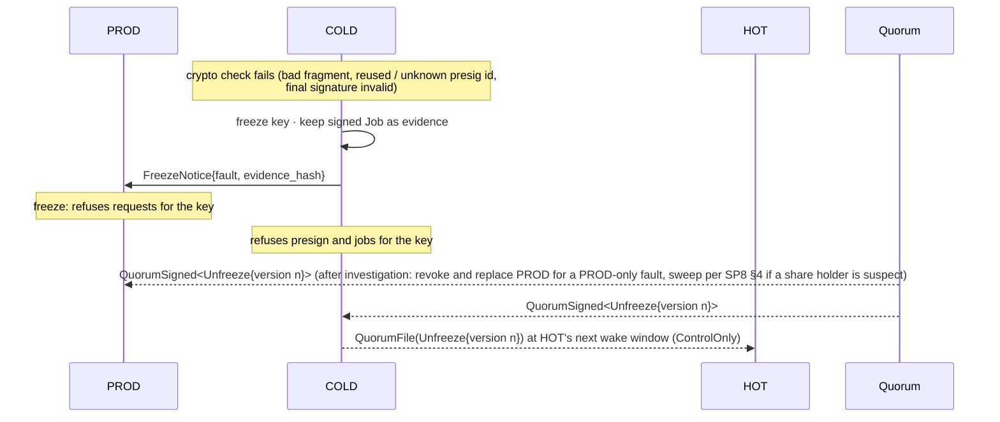

What freezes a key and what doesn't:

| Event | Freezes? | Why |
|---|---|---|
| Invalid fragment / final verification failure (`FAULT_PROD_FRAGMENT`, `FAULT_FINAL_VERIFY`) | **yes** | proof of misbehaviour or corruption |
| Presig id never issued, or reused inside the current open block (`FAULT_PRESIG_STATE`) | **yes** | replay or rollback on PROD |
| Presig id in any closed block, below a discarded floor, or already orphan-deleted | **no** (`REJECTED`, burned) | ordinary restart, block advance, restore handling or orphan cleanup |
| DKLs23 R3 / FROST commitment failure in presign (`FAULT_PRESIGN`) | **yes**, no retry | repeated aborts can leak share bits |
| COLD: restore detected (at boot, before incrementing, a pool's sealed record of the counter value it last set is below the hardware counter) | discard that pool | its stored state is stale, so the erasure assumption is broken; ids in closed blocks are refused regardless |
| Policy reject, expiry, ssid mismatch, timeout | **no** | ordinary failures must not become outages |

Only a quorum-signed `Unfreeze` clears a freeze. Each party checks the quorum signatures itself and refuses an old counter, so a captured `Unfreeze` cannot be replayed.

#### 4. Policy

- **Policy content is outside the protocol.** Limits, allowlists, accepted transaction types, velocity rules, risk scoring and any human approval are the deployer's choice.
- **What the protocol requires: two independent validations of every withdrawal, from two independent policy sources.** PROD and COLD must not depend on the same source of rules or data (allowlists, limits, prices, risk scores, chain state, time); which sources they use is the deployer's choice.
- **Two independent validations.** PROD validates at admission, before any presignature is used; COLD validates before it combines. Each works from its **own decode** of `raw_tx` and its **own state** (limits, ledger), and each can refuse alone. Neither relies on the other's verdict, data or code.
- **Versioning.** Deployer policy reaches each party as a policy-quorum-signed `PolicyBundle` naming that party as its `target`; a party refuses any bundle addressed to the other, so PROD's and COLD's policies stay independent even with a single policy quorum. PROD's and COLD's bundles have separate monotonic version sequences. Each party's version in force is named in every `WithdrawalEnvelope` (`prod_policy_ver`, `cold_policy_ver`); each party checks only its own and refuses a request written against another version.
- *Non-normative note for deployers:* value limits alone do not cover contract calls (for example a zero-value token approval), so a policy should state which transaction types it accepts.

#### 5. Security properties

- **Detection is local and immediate.** Any party freezes on its own evidence. Recovery needs a quorum.
- **No single operator can unfreeze, unrevoke or loosen policy**, and older control messages cannot be replayed.
- **Freezes are attributable:** the evidence hash points to the signed frame that caused them.

---

<a id="sp8"></a>
### SP8 · Refresh & PROD replacement (ceremonies)

#### 1. Purpose

- **Refresh:** re-randomise every share while keeping the same group key, so that shares stolen before the refresh become useless.
- **PROD replacement:** replace PROD, which holds no share, without any key ceremony.
- **Not in CHP: recovery of a lost or compromised share holder.** CHP never rebuilds or reuses a key after a share holder is lost or may be compromised. The survivors sweep the funds to a real cold wallet under the deployer's incident-response procedure; §4 gives guidelines, not a protocol.

Refresh runs in a ceremony on the isolated network ([SP2](#sp2) setting), produces a **new `key_version`**, and ends with share delivery ([SP3](#sp3)).

#### 2. Refresh

**When:** on a schedule (e.g. quarterly), or after any change of operator or enclave. **Not** after a possible share-holder compromise: that is §4.

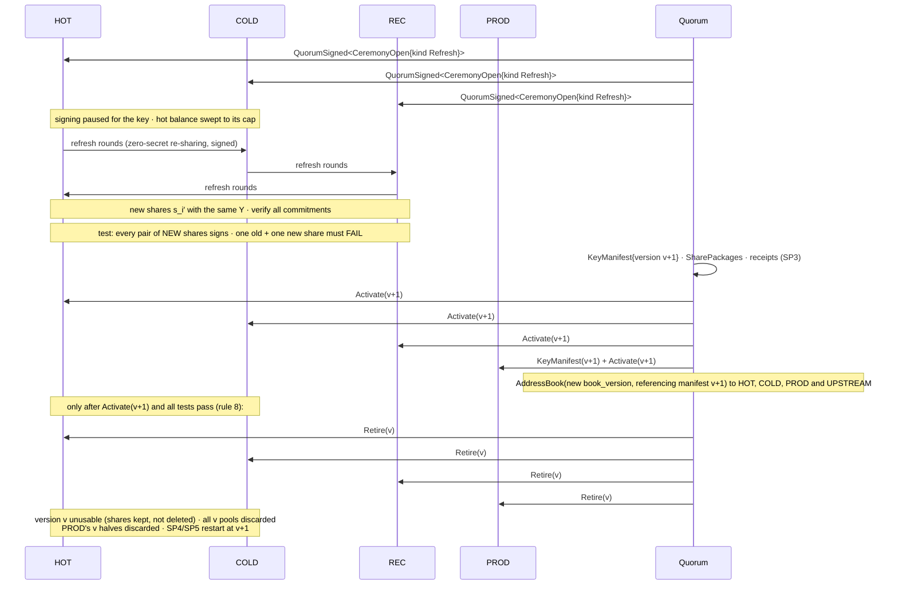

Primitives:

- DKLs23: key refresh.
- FROST: refresh DKG (a fresh sharing of zero).

Each party adds a fresh sharing of zero to its share, so `Y` is unchanged and every share changes. After `Activate(v+1)`, every receipt, and a verified test signature from every pair of new shares, `Retire(v)` makes the old version **unusable**: the engines refuse to presign or sign with it. The protocol does not delete the old shares (rule 8). **Deployer note:** refresh only protects against shares stolen earlier if the old shares are then physically destroyed, because two old shares still sign for the same key. Plan that destruction as a deployer operation (section 7).

#### 3. PROD replacement (no key ceremony)

PROD holds no share, so no key ceremony is needed: revoke PROD's certificate ([SP1](#sp1)), which discards every pool; enroll a new PROD; restart SP4/SP5.

Exception, for every protocol: if COLD may have been compromised at the same time as PROD, the key (DKLs23) or HOT's long-term share (FROST) may be exposed. Treat that as a share-holder compromise (§4).

After enrolling the new PROD, deliver its `PartyCert` to HOT as a quorum file at HOT's next wake window (HOT needs it to seal media bundles), and on the QR route issue a new `QrPairing`.

#### 4. Loss or compromise of a share holder (guideline, outside CHP)

**Rule: sweep, never repair.** If HOT, COLD or REC is lost, or may be compromised, assume the protocol or its implementation may have failed. Do not reshare, repair or refresh that key. The two surviving share holders sign a **sweep of all funds to a real cold wallet** (for example an HSM-based cold storage system), under the deployer's own incident-response procedure. If the hot wallet is to resume, a new key is created from scratch (SP2), with new enclaves for any suspect party.

| Lost or suspect | Who signs the sweep |
|---|---|
| HOT | COLD + REC |
| COLD | HOT + REC |
| REC | HOT + COLD |
| two share holders | nobody: unrecoverable by design; loss is bounded by the hot-balance cap |

What the deployer must know:

- **The sweep is not a CHP runtime path, on purpose.** It is interactive signing in a quorum-opened offline ceremony, with no presignatures. CHP gives no live path to it.
- **Pre-register the destination.** Sweep only to a cold-wallet address registered in advance with a quorum-signed address book; never to an address supplied during the incident.
- **Cover every asset:** the native coin, each token separately, staked, vesting or locked funds (scheduled when they unlock), and on EVM chains contract ownership and admin roles held by the address, plus **token approvals the old address granted**, which stay valid after a sweep.
- **Late deposits.** Retire the old addresses at once ([SP10](#sp10)) and watch them. Keep the survivors' old shares until the addresses have stayed empty for a set period; ideally move them fully offline (REC plus an offline vault HSM) so live parties hold only the active key.
- **Nothing is destroyed during an incident** (rule 8): the protocol only freezes. Destroying the old shares is a later deployer decision, after the sweep is confirmed on chain and the watch period has passed.
- **Speed.** One stolen share cannot sign, so the sweep is a planned operation, not a race.

#### 5. Security properties

- Refresh makes any share stolen before it useless against the new version, and the ceremony verifies this (old + new shares must fail to sign). Full protection also needs the deployer to destroy the old shares (section 7).
- A possibly compromised key is never reused: survivors only sweep.
- The protocol never deletes a share; old versions become unusable only after the replacement is proven (rule 8).
- Every ceremony output is quorum-signed, versioned and forward-only. Old versions are retired, and old pools are discarded everywhere.
- The COLD-HOT-PROD split pays off here: compromise of the online machine (PROD) needs no ceremony.

---

<a id="sp9"></a>
### SP9 · QR transport: air-gapped COLD

#### 1. Purpose

Let a deployer run COLD with **no network interface towards PROD at all**. The PROD ⇄ COLD messages of SP5 (activation) and SP6 (signing) cross as QR codes: one side displays, the other side's camera scans, and an operator carries the exchange. Everything else is unchanged:

- the message bodies, signatures and checks are those of SP1, SP5 and SP6;
- COLD ⇄ HOT (SP4 and the wake window) stays on the isolated network;
- PROD broadcasts, as in the linked route.

A COLD replica uses **one route only**, linked or QR, fixed at enrollment.

#### 2. What changes compared with the linked route

| | Linked route | QR route |
|---|---|---|
| Transport | mTLS link, COLD dials PROD | display → camera, operator-carried |
| Peer binding | `LinkHello` + TLS exporter | quorum-signed `QrPairing{channel_id, cold_cert_hash, prod_cert_hash}`; every frame names the channel and its recipient |
| Ordering | per-stream sequence, reset per link | per-direction sequence, **persistent**, never reset |
| Liveness | link loss aborts pending batches | deadlines: jobs expire at `not_after`; pending batches abort at `import_deadline` |
| Who starts | COLD dials | PROD displays a frame; COLD only answers, or displays control messages |
| Latency | one network hop | operator-bound (tens of seconds to minutes) |

#### 3. Frame format

```
QrFrame { channel_id, from = H(sender id_pk), to = H(recipient id_pk), dir_seq, msg }
sig = Ed25519(id_key, "chp-qr-v1" ‖ channel_id ‖ to ‖ dir_seq ‖ type ‖ SHA-256(body))
```

`msg` is an SP1 `SignedMsg` whose signature covers the QR binding above in place of the link sequence, so a frame cannot be replayed onto another channel or towards another replica.

The frame is encoded as deterministic CBOR, then split into **fountain-coded parts** shown as an animated QR sequence. Every part carries the total length, its part index and the SHA-256 of the whole frame. Hard caps on frame size and part count are checked before any decoding.

#### 4. Messages allowed on the QR channel

| Direction | Messages |
|---|---|
| PROD → COLD | `Job`, `TransferAck`, `PoolStatus`, `PresignAbort`, `FreezeNotice` |
| COLD → PROD | `Status` (with `signed_tx`), `PresignActivate`, `PresignAbort`, `OrphanDelete`, `FreezeNotice` |

Nothing else: no presign rounds, no wake messages, no key-management types and no `LinkHello`. Anything else is refused before it is parsed.

#### 5. Flows

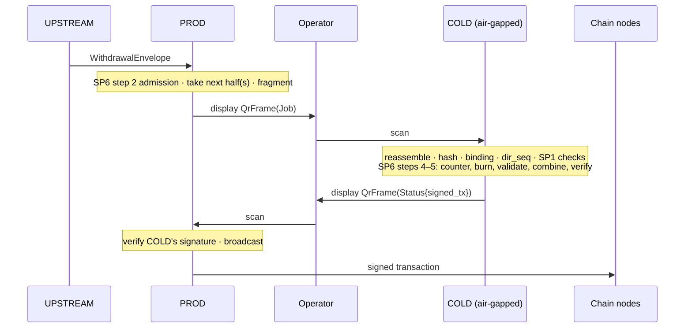

**After a COLD boot**, COLD first displays its `OrphanDelete` frame; the gap rule makes PROD scan it before any later frame, so PROD skips the closed-block halves. Until it is scanned, any job using them is burned and `REJECTED`.

Batch activation (SP5) works the same way: PROD displays `TransferAck`, COLD scans it and displays `PresignActivate`, PROD scans that. One operator session may carry several jobs; each is its own frame, processed in sequence.

#### 6. Checks at the receiver, in order

1. Size and part-count caps, before decoding anything.
2. Reassemble the parts and check the SHA-256 of the whole frame.
3. `channel_id` is the paired channel and `to` is this party.
4. `from` is the paired peer, with a valid, unrevoked certificate.
5. `dir_seq == last + 1`. A lower sequence is a duplicate: if it is byte-identical to a frame already handled, the stored reply is displayed again; otherwise it is refused. A gap is refused, and the sender re-displays the missing frame.
6. The SP1 checks: the role may send this type, the signature, the canonical body.

Only then is `dir_seq` advanced and the message handled.

#### 7. Failure handling

| Failure | Result |
|---|---|
| Unreadable scan, bad hash, oversize frame | refused; no state change; **not** a freeze (camera errors are ordinary) |
| A job is never scanned | later frames are refused until it is (gap rule); the operator scans it late, and COLD burns its halves and returns `EXPIRED` |
| A Status never reaches PROD | PROD re-displays the same `Job` frame; COLD re-displays its stored `Status`. COLD never signs twice |
| A `TransferAck` is not carried before `import_deadline` | COLD aborts the batch (SP5) |
| A cryptographic fault (bad fragment, final verification fails) | as in SP6: `FAULT`, the key freezes ([SP7](#sp7)) |

#### 8. Security properties

- COLD has **no network path from PROD**; its only input from PROD is the camera, and each operation carries a bounded amount of data.
- Frames are bound to one channel and one recipient, so they cannot be redirected to another replica.
- Persistent sequence numbers stop replay and reordering. A replayed `Job` cannot yield a second signature, because COLD's per-pool high-water mark (protected by the hardware counter) refuses used ids.
- The QR decoder is untrusted input: it runs sandboxed, size-capped and fuzzed, like the link parser (section 6.1).
- The route trades the 100 ms target for isolation. It suits amounts above a deployer-set threshold or high-security deployments.

---

<a id="sp10"></a>
### SP10 · Address book & address proof

#### 1. Purpose

Anyone who sends funds to the wallet, or relies on its addresses, must be able to prove that an address **belongs to the key produced by the ceremony**, and not to an address substituted by a compromised PROD, UPSTREAM, front end or database. Most designs forget this: the key is protected, but the address shown to depositors is not.

SP10 gives every address a proof that anyone can verify **offline, against the pinned quorum roster alone** (as updated by verified `RosterUpdate`s, when quorum separation is used):

- the ceremony quorum signs an `AddressBook` derived from the group key in the `KeyManifest`;
- the key itself signs a control statement for each address during the ceremony;
- PROD stores the book and answers any authorised requester with a signed `AddressProof`.

PROD's signature only adds freshness and accountability. **The proof never depends on trusting PROD**: the verifier recomputes everything from quorum-signed data.

#### 2. The address book

Produced at the end of SP2 (including each high-security DKG cycle, which creates a new key) after the test signatures. A refresh (SP8) keeps the same key and addresses, so the book only gets a new version referencing the new manifest; control signatures stay valid because they do not name the key version:

```
AddressBook {
  key_id, key_version, manifest_hash, book_version,
  entries: [ { chain, path, encoding, address, status, valid_from, control_sig } ]
}   quorum-signed
```

- `address` is derived from the group key `Y` in the manifest and `path` with CHP's derivation (`P = Y + t_path·G`, SP6 §4), then encoded by the chain's public rules: for example P2WPKH, or P2TR with the BIP86 output key `Q` of the derived key (bech32m) for Bitcoin; for EVM, the last 20 bytes of Keccak-256 of the 64-byte uncompressed derived public key; the root public key itself for Ed25519 chains (Ed25519 keys have exactly one, root, path entry).
- `path` is the same path that presignatures are bound to ([SP4](#sp4)). **The book also limits signing:** HOT refuses to presign, and COLD refuses to sign, for any path that is not an `Active` entry in the current book. A path outside the book can never be signed for.
- **New addresses need a ceremony.** Because `control_sig` is a signature by the key itself, a new entry is added only in a quorum-opened ceremony (`CeremonyOpen` kind `AddressSign`) with any two share holders (a normal 2-of-3 signature; DKG and refresh are the only ceremonies that need all three), which signs the control statement and issues a new `book_version`.
- `control_sig` is a **signature by the derived key itself**, produced in the ceremony (SP2, or an address ceremony) by two share holders, over a domain-separated statement:
  `H("chp-address-control-v1" ‖ chain ‖ key_id ‖ path ‖ address)` (a BIP340 tagged hash for Taproot). The domain tag makes it impossible for this signature to be a valid transaction signature. It proves the key holders **controlled** the address at the ceremony, not only that it was derived.
- `status` is `Active` or `Retired`. A new `book_version` (monotonic, quorum-signed) retires addresses, for example when a key is replaced by a new key in a high-security DKG cycle. Retired addresses stay in the book so old deposits can still be explained.

Delivered with SP3 to HOT, COLD, PROD and UPSTREAM as public data; later versions reach HOT as a quorum file at its next wake window, before any presign. Each verifies the quorum signatures and refuses a `book_version` at or below the last one it accepted.

#### 3. Address proof on request

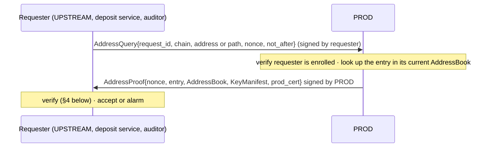

- PROD answers only from its stored book; it has no way to create entries.
- *Guideline:* which systems may query is the deployer's choice. Recommended: UPSTREAM plus any deposit or audit service, each enrolled through SP1 with its own certificate, so every answer is attributable to a known requester.
- An address that is not in the book gets a signed `NotFound`; it is never "probably ours".
- The proof is self-contained, so the requester can keep it as evidence and anyone can re-check it later.

#### 4. Verification by the requester, in order

1. The `KeyManifest` and `AddressBook` carry valid quorum signatures under the **pinned roster** (plus any verified `RosterUpdate`s), and `book.manifest_hash == H(manifest)`.
2. `book_version` is not older than the last one this requester accepted.
3. **Recompute the address** from `Y` in the manifest, the entry's `path` and the chain's encoding rules; it must equal `entry.address`.
4. `control_sig` verifies under the derived public key for the domain-separated statement (for Taproot, the BIP86 output key `Q`, matching how the key signs transactions).
5. `entry.status` is `Active` (for a new deposit) and the time is after `valid_from`.
6. PROD's signature, certificate and the echoed `nonce` verify (freshness and accountability only).

Any failure is an **alarm**, not a retry: it means some system tried to present an address the ceremony did not produce.

#### 5. Where the book is also used

- **Change outputs.** PROD and COLD can check that every output claimed to return to the wallet goes to an `Active` address in the book. Whether policy requires this is the deployer's choice ([SP7 §4](#sp7)); the book gives both parties an independent reference.
- **Deposit pages and front ends** should show addresses only from a verified proof, and can expose the proof so depositors or auditors can check it themselves.
- **Sweeps and refills.** Destinations of sweeps to warm or cold wallets should come from equivalent quorum-signed books for those wallets.

#### 6. Security properties

- **Provenance:** every address traces to the ceremony key through quorum-signed data and a signature by the key itself.
- **No trust in PROD:** a compromised PROD can refuse to answer or answer with an old book (caught by `book_version`), but it cannot produce a valid proof for a foreign address.
- **No trust in the transport or front end:** proofs are verifiable offline against the pinned roster.
- **Retirement is explicit and monotonic:** an attacker cannot revive a retired address with a replayed old book.
- **Residual risk:** a requester that does not verify, or that pins the wrong roster, gets no protection. Verification belongs in every system that displays or stores an address.

---

## 5. The deployer's part: questions 4 and 5

The protocol cannot enforce how people and code are organised. It is built so that a deployer can, and it gives them the hooks to do so.

### Question 4 · Human roles

| Requirement on the deployer | How CHP supports it |
|---|---|
| Different teams operate COLD, HOT, PROD and REC; nobody has physical, remote and CI/CD access to two of them | every party is a separate enclave with its own identity; nothing in the protocol needs shared credentials |
| **Independent teams manage each policy source.** The rules and data feeding PROD's checks (allowlist, limits, price or risk oracle, chain node provider) and those feeding COLD's checks are maintained by different teams, with no person able to edit both. Otherwise independent sources collapse into one point of failure, exactly like one team running every party | PROD and COLD each read only their own policy source (SP7 §4); policy versions are quorum-signed, and the policy quorum can be split by source (SP1 quorum separation) |
| Separate custodians for each key share and for the quorum keys | shares are delivered sealed to one attested enclave each (SP3); REC lives in its own HSM |
| No single person can unfreeze, revoke, change policy or move a share | these actions require an **M-of-N quorum** signature, and each party verifies it itself (SP1, SP7) |
| Where affordable: separate quorums per function and roster rotation without a release | SP1 quorum separation: function-specific rosters and quorum-signed `RosterUpdate` |
| Ceremonies with an admin quorum, written script, recording and signed logs | SP2, SP3 and SP8 are quorum-run, with signed manifests and receipts |
| Media carried by someone who is not the recipient's custodian | media bundles are ciphertext for the recipient enclave only (SP3, SP5) |

### Question 5 · Codebase & supply chain

| Requirement on the deployer | How CHP supports it |
|---|---|
| Separate build pipelines and signing keys per party; staged rollouts, one party at a time | each party's certificate binds its own enclave measurement; the release keys are per pipeline |
| An independent implementation on at least one party, especially the policy engine and transaction decoder on COLD | the wire format is fully specified (deterministic CBOR, domain-separated signatures; section 4), so a second implementation can interoperate; COLD's checks do not rely on PROD's code |
| Reproducible builds, audited dependencies, a pinned and verified MPC library | the MPC library is pinned and verified against its upstream source before every release |

## 6. What remains a single point of failure, honestly

- **Two of three.** Compromising two share holders (any two of COLD, HOT, REC, or PROD together with COLD) loses the key. That is inherent to 2-of-3. The design's job is to make those two genuinely independent, along all five questions above.
- **Questions 4 and 5 are out of the protocol's reach.** If one team runs every party, or one pipeline builds every party, the multiple points of failure collapse back into one, whatever the cryptography.
- **PROD + COLD presignature halves are key-equivalent.** Both halves of one unused DKLs23 presignature reveal the private key directly (`x = Σs₀′ / (r·Σφ)`); for FROST, `s′_h` and `δ` reveal HOT's share. This is inherent to presignatures, not a flaw of the MPC library, and cannot be removed at protocol level. It makes **COLD the critical party**: it appears in three of the four key-losing pairs, and the realistic attack is *breach PROD (internet-facing), then pivot to COLD*. COLD is therefore designed assuming PROD is already hostile (section 6.1).
- **Bounded loss.** A hot-balance cap with automatic sweep to warm/cold wallets limits what any successful attack can take. This is a deployment control the design assumes.

### 6.1 COLD hardening

- **Minimal interface.** COLD accepts a closed set of message types (wake and presign from HOT; jobs and control from PROD), one job at a time. Canonical frames with hard size limits; parsing runs in a separate sandboxed process that hands only typed values to the signing core; all decoders are fuzzed.
- **COLD is authoritative on its own state.** Moves towards safety (abort a batch, discard a pool, freeze) are COLD's alone and never wait for PROD. Moves that grant capability (activate a batch) still need the matching digests, so a substituted media bundle cannot be activated; PROD's ack only affects liveness, never what COLD will sign.
- **Policy from COLD's own data only.** COLD never relies on balances, nonces or UTXO data supplied by PROD; for UTXO chains it computes the sighash itself (amounts are committed by SegWit/Taproot).
- **Broadcast from PROD, not COLD.** A signed transaction holds no secret; removing COLD's chain egress leaves it with only the HOT and PROD links (only the isolated HOT link on the air-gapped route below).
- **Anti-rollback counter.** Within each pool, presignatures are consumed strictly in increasing id order, and COLD's high-water mark is protected by a hardware monotonic counter so that restoring storage from a snapshot cannot resurrect a used half. A rollback of COLD while an attacker holds copies of PROD's halves would leak the key publicly, so this path must be covered by the audit and by drills.
  - **What the hardware gives:** a counter that can only go up by one per increment, keeps its value across power loss, and lives outside the storage that can be restored. Options: a TPM 2.0 NV index with the counter attribute (`TPM2_NV_Increment`); an HSM counter object (PKCS#11 monotonic-counter hardware feature, or a counter kept in custom HSM firmware); RPMB, the replay-protected memory block of eMMC/UFS storage, used by TrustZone TEEs. Not every TEE has one: SGX's counters are deprecated and AWS Nitro Enclaves has none, so such platforms need an external counter (an HSM or TPM, or a set of independent witness parties that each sign the latest value). This constrains the platform choice for COLD.
  - **How it "auto-increases" without wearing out:** hardware counters have limited write endurance and take milliseconds, so COLD does not increment per presignature. Presignature ids are grouped in **blocks** (one block per SP4 batch). **Each pool `(key_id, key_version, path)` has its own hardware counter** (TPM NV indexes and HSM counter objects come in multiples; the design keeps few paths), holding that pool's current block number. COLD increments every pool's counter (1) **at every boot**, which closes each pool's block in use (before accepting any job, COLD sends PROD an `OrphanDelete` for the unused ids of the closed blocks and of any discarded pool, so PROD skips them), and (2) when consumption in a pool first enters its next block (not when a batch is allocated, so a refill never burns the previous batch). Within a block, the high-water mark is kept in enclave memory. COLD also seals, with its state, the counter value it last set; at boot, before incrementing, a sealed value below the hardware value means the state was restored, and that pool is discarded (SP7). **Discarding sets a floor**: every id up to the pool's current block is refused, while new batches above the floor stay usable, so the pool `(key_id, key_version, path)` itself keeps working. Any id in a block its pool's counter has passed is refused. Using one pool never burns or closes another pool's presignatures.
  - **Why that is enough:** a storage restore only takes effect after a restart, and every restart closes the open block, so ids from before the restore can never be used again. The cost is burning the unused rest of the open block at each restart. The TEE must also prevent restoring a *running* memory image (VM-based TEEs such as SEV-SNP and TDX protect memory integrity); where it cannot, increment per presignature instead.
  - HOT's wake counter (SP4) is a separate hardware monotonic counter, without blocks, incremented by exactly one per accepted wake window or `CeremonyOpen`; a request must carry exactly the next value.
  - **Deletion and the counter work as a pair.** Deleting each half on use stops reuse in normal operation; it cannot stop a storage restore, which brings deleted halves back. The counter stops the restore: the restart closes the block, so every restored id is refused. Only COLD needs this: a rolled-back PROD that reuses its half is refused by COLD.
  - **Conditions for the pair to hold:**
    1. **Sealing key and counter in the same hardware.** COLD's stored halves are sealed under a key held by the same TPM/HSM as the counter, so copying the storage to another machine with a fresh counter yields nothing, and resetting the hardware wipes counter and sealing key together.
    2. **No rollback of a running memory image.** A live snapshot resumed without a restart never advances the counter; this needs a TEE with memory-integrity protection (SEV-SNP, TDX), or else a counter increment per presignature.
    3. **No backup or cloning of the counter or the halves.** HSM backup/clone features must be disabled for these objects, since restoring a cloned counter rolls it back.
    4. **New hardware means a new replica.** Moving COLD to new hardware gives it a new replica id range and discards the old pool; old halves are never carried to a fresh counter.

### 6.2 Operating modes (deployer's choice)

- **COLD route.** *Linked*: COLD pulls jobs over its outbound link; fast path, sub-second. *Air-gapped ([SP9](#sp9))*: jobs and signatures cross by QR code, so COLD has no network path to PROD (only its isolated link to HOT); operator-in-the-loop, minutes per job, used for amounts above a deployer-set threshold or for high-security deployments. QR capacity is small (about 2.9 KB per static code), so multi-input jobs need animated/fountain-coded QR; the QR decoder is untrusted input and gets the same hardening as the link parser.
- **HOT lifecycle** ([SP4](#sp4), wake window). HOT sits on the same isolated network as COLD, is powered off by default, and wakes only when operators at both COLD and HOT agree on the return stage. Signing continues meanwhile. The deployer's mode sets the allowed return stage:
  - *Standard*: return to presign sync, to refill the pool with the same key.
  - *High security*: return to the DKG phase; every refill is a new key, and funds move to it under the hot-balance cap and sweep. The old key is retired (unusable), not deleted; destroying the old key's shares (HOT, COLD and REC) is a deployer operation, recommended only after the new key is active and tested, the old balance is swept and its addresses are retired (section 7). Costs a quorum ceremony with REC each cycle.

### 6.3 Open items

- **Availability risks:**
  - COLD is a liveness single point of failure: no COLD, no signatures. HA needs replicas with disjoint presignature id ranges, never a shared active-active pool.
  - **Freeze is the incident-response path, by design.** Any cryptographic fault, including one caused by PROD, freezes the key until a quorum `Unfreeze` (SP7). Accepted trade-off: a compromised PROD can force a freeze, turning a breach into an outage instead of a loss.
  - Pool exhaustion: refills depend on media logistics (and, in high-security mode, a DKG ceremony). On UTXO chains every input consumes a presignature. Track days of runway at peak, multi-input volume, and alert well before the next scheduled trip.
  - Policy independence under PROD compromise: once PROD is breached only COLD's check remains. An independent approver that is not PROD (separate provider and codebase, approving the session id) would restore two checks.
- **FROST split construction**: needs independent cryptographic review before use; it is outside FROST's security proof. PROD + COLD together recover HOT's long-term share (`s_h = s′_h − δ`), which survives a pool discard, so a joint compromise is treated as a share-holder compromise (sweep). Requirements and fallback: [SP6 §4.2](#sp6).
- **Taproot signing math** (SP6 §4.2: sign factors, `t_eff`, the signed fragment check) and CHP's path derivation `t_path`: CHP's own construction, checked by hand only. It needs independent cryptographic review and BIP340/BIP341 test vectors (odd-y derived keys and nonces included) before use.
- Any implementation needs an independent audit before deployment.
- SP8 refresh primitives must be audited before production. Share-holder recovery needs no resharing protocol: it is a sweep under the deployer's incident response (SP8 §4).

## 7. Notes: side effects of the protocol

The protocol has exactly two kinds of destructive action: it **deletes presignature material** and it **freezes** a key. It never deletes a key share (rule 8). Everything else it does is either reversible or only makes material unusable.

**What the protocol itself does**

| Side effect | Where | Trigger | Reversible? | What it can cost |
|---|---|---|---|---|
| Delete a presignature half (PROD, COLD) | SP6 | each use | no | one presignature |
| Burn skipped presignature ids (COLD) | SP6, SP9 | a job names higher ids | no | presignatures |
| Burn the rest of each pool's open id block (COLD) | 6.1 | every COLD restart | no | up to one block of presignatures per pool |
| Erase halves, `δ`, `s′_h` on HOT after export | SP5 | export | no | one batch, if the media is lost |
| Delete pending halves on abort | SP5 | abort, digest mismatch, deadline | no | one batch |
| Delete orphan halves (`OrphanDelete`) | SP7, 6.1 | `PoolStatus` shows a half held by only one side; or a COLD boot (closed blocks, discarded pool floor) | no | those presignatures |
| Discard presignature pools | SP1, SP7, SP8 | revocation of HOT, COLD or PROD (every pool); restore detected (that pool); new key or key version (the old key's or version's pools) | no | those presignatures (regenerated by SP4) |
| Erase wake-session state, power off HOT | SP4 | window closes | yes (next window) | none |
| Freeze a key | SP7 | cryptographic fault | **yes** (quorum `Unfreeze`) | outage until unfrozen |
| Advance sequence numbers and counters | SP1, SP4, SP6, SP9 | every frame, job, wake, boot | no | replays are refused |

**What makes material unusable, without deleting it**

| Effect | Where | Trigger | Reversible? | Notes |
|---|---|---|---|---|
| Revoke a party certificate | SP1 | quorum `RevocationList` | no: the party never links again | revoking a share holder strands its share; do it only with a sweep plan (SP8 §4) |
| Retire a key version | SP8 | after refresh or a new key, once the new version is active and tested | no | engines refuse to presign or sign with it; shares are kept |
| Retire addresses | SP10 | new `book_version` | no (monotonic) | entries stay listed and watched for late deposits |

**Deployer operations outside CHP (guidelines)**

The protocol never performs these; the deployer decides when, under quorum control:

- **Destroying old shares after a refresh.** Needed for refresh to protect against earlier theft (two old shares still sign). Do it only after `Activate(v+1)`, all receipts and a test signature from every pair of new shares.
- **Zeroizing ceremony instances.** Only after the recipient's `ShareReceipt` and `Activate`.
- **Destroying a retired key's shares** (old high-security cycles, keys swept after an incident). Only after the balance is swept, the addresses retired and watched empty for a set period; until then keep them, ideally fully offline.
- Never run a destructive step under time pressure, and always confirm first that the replacement works (a test signature) before destroying what it replaces.

## 8. Notes: using presignatures

A presignature is the most dangerous object in CHP: both halves together are equivalent to the key (section 6). These are the rules for using one, collected from SP4–SP7 and SP9 in one place.

**What a presignature is bound to.** Fixed at `PresignOpen` and carried in the batch digest and every `ssid`; it cannot be used for anything else:

| Bound to | Consequence |
|---|---|
| `key_id` + `key_version` | unusable after refresh or a new key (pool discarded) |
| signer pair {HOT, COLD} | only HOT's half (on PROD) and COLD's half can combine |
| derivation `path` | one pool per path; the path must be `Active` in the address book (SP10); see the trade-off in SP4 |
| pool `(key_id, key_version, path)` and id layout `hot_replica ‖ cold_replica ‖ block ‖ index` | each pool has its own ids, high-water mark and hardware counter; replicas never share ids |
| id block (hardware counter, section 6.1) | a block closed by a restart can never be used again |

**Life of one presignature**

1. **Created** in SP4 inside a HOT wake window; COLD's half is `Pending`, HOT's half leaves sealed for PROD (SP5).
2. **Activated** only when COLD's digest, HOT's export digest and PROD's import digest all match (SP5).
3. **Used** once, for one input: one per UTXO input, one per account-based transaction.
4. **Ended** by exactly one of: used; burned as a skipped id; the rest of its block burned at a COLD restart; deleted as an orphan (`OrphanDelete`); its batch aborted; its pool discarded (revocation, restore detected, new key or key version).

**Rules when using it (SP6)**

- **Order, per pool.** PROD always takes the next id of the path's pool, strictly increasing. COLD refuses any id at or below that pool's high-water mark and burns lower ids of that pool only; other pools are untouched.
- **Delete before compute.** Both PROD and COLD delete the half durably before computing anything with it, so a crash burns it rather than risking reuse.
- **Never retried.** A failed, rejected or expired job does not give its presignature back. A cryptographic fault freezes the key (SP7).
- **Never copied.** A half is never backed up, snapshotted, exported or logged. The only move ever allowed is HOT → PROD as a sealed media bundle. FROST `δ` values move only HOT → COLD, sealed in `ShareMasks`, and die with their half.
- **Restore = burn.** Only COLD detects a restore (section 6.1) and discards the affected pool; COLD's hardware counter makes old ids unusable even if a restore goes undetected. A rolled-back PROD needs no detection: COLD's per-pool high-water mark refuses any id PROD already used. This holds only under the four conditions in section 6.1: sealing key and counter in the same hardware, no running-memory rollback, no backup or cloning of counter or halves, and a new replica on new hardware.

**What consumes presignatures (for pool sizing)**

| Consumer | Notes |
|---|---|
| Signed inputs | one per input; multi-input UTXO transactions consume many |
| Jobs rejected or expired at COLD | already burned on both sides (requests refused at PROD admission cost nothing) |
| QR jobs scanned too late | burned on both sides, returned as `EXPIRED` |
| COLD restarts | burn the unused rest of each pool's open block |
| Aborted batches, discarded pools | the whole batch or pool |

Size each path's pool for peak volume (counting multi-input transactions) plus these losses, and alert while there is still enough runway to open a HOT wake window, which needs operators at both COLD and HOT.

## 9. Notes: for the policy engine and deployment (outside the protocol)

CHP only requires that PROD and COLD each validate every request independently ([SP7 §4](#sp7)). What they must check is the deployer's policy engine. These items are commonly missed and decide what a signature actually authorises.

**1. Sighash and replay rules per chain**

- **Bitcoin / UTXO:** accept only `SIGHASH_ALL` (or `SIGHASH_DEFAULT` for Taproot). `NONE`, `SINGLE` and `ANYONECANPAY` let a third party change outputs or add inputs after signing. Accept only SegWit/Taproot inputs, so input amounts are committed in the sighash.
- **EVM:** check the chain id (EIP-155 or typed transactions) against the chain the key is meant for, so a signature cannot be replayed on another EVM chain where the same key holds funds. Prefer one key per chain family, or at least per chain id policy.
- **Other chains:** apply the equivalent rules (network id, genesis hash, memo or destination tags).

**2. Sign only real transactions**

- COLD's decoder accepts only transaction formats it can fully decode for that chain. Raw hashes and `personal_sign`-style messages are refused.
- Off-chain typed messages (EIP-712) are refused unless the policy explicitly decodes them: a `permit` signature is a token approval and must pass the same checks as a transfer.
- Value limits alone do not cover contract calls: a zero-value `approve()` or an arbitrary call can drain tokens. The policy states which transaction types and contract calls it accepts.

**3. Trusted time**

- Request expiry (`not_after`), certificate validity and wake deadlines all depend on time. COLD, and especially an air-gapped COLD on the QR route, has no network time, and its local clock can be set by whoever controls the host.
- Use signed time from at least two independent sources (for example timestamps signed by UPSTREAM and by PROD, accepted only if they agree within a bound), with the local clock used only as a monotonic floor that never moves backwards. Never trust a single source or the local clock alone.

**4. Software updates of share holders**

- If a share is sealed to the exact enclave measurement, a new build cannot unseal it. Choose deliberately:
  - seal to the **release-signing identity** (any build signed by the release key can unseal), which makes updates simple but trusts the release key with the share; or
  - seal to the exact measurement and move the share to the new build in a **quorum ceremony** (SP3-style delivery), which is slower but keeps the release key away from shares.
- Updates are the moment a malicious build would enter. Roll out one party at a time, with separate pipelines and release keys per party (section 5, question 5), and never update two share holders in the same window.

## 10. Notes: operations and monitoring (outside the protocol)

These are deployer responsibilities. CHP does not perform them, but a deployment without them misses attacks and outages.

**1. On-chain reconciliation**

- Every outgoing transaction from any address in the address book ([SP10](#sp10)), active or retired, must match a COLD-signed `Status` (txid, request id).
- A transaction with no match means a signature was produced outside the protocol: treat it as a possible key compromise, freeze, and start the sweep procedure ([SP8 §4](#sp8)).
- Reconcile from independent chain sources, not only PROD's view: PROD is the internet-facing party and can withhold or misreport.
- UPSTREAM should confirm withdrawals by txid on chain, because a compromised PROD can withhold a signed transaction after COLD returns it.

**2. Tamper-evident audit log**

- Each party appends every accepted frame, refusal, freeze, wake window, batch state change and ceremony step to a hash-chained log, signed with its enclave key.
- Logs are exported off each party to separate storage, controlled by a different team, so no single operator can rewrite history.
- The signed frames CHP already produces are the evidence; the log makes them complete and ordered.

**3. Certificate and key expiry**

- Party certificates (e.g. 90 days), the UPSTREAM key, quorum keys and release keys all expire or need rotation. A missed renewal stops signing.
- Keep a renewal calendar, alert well before expiry, and rotate the UPSTREAM key by issuing a new quorum-signed `PartyCert` and revoking the old one.

**4. Drills**

- Rehearse on a schedule, on a test deployment: a HOT wake window, a QR session, a refresh ceremony, a freeze and quorum `Unfreeze`, and the full sweep to the cold wallet.
- Untested incident paths fail when they are needed; drills also keep custodians and quorum members reachable and practised.

**5. Chain-level liveness**

- **EVM nonces:** someone (normally UPSTREAM) owns nonce management. A stuck transaction or a fee replacement needs a new signature, which consumes a new presignature, and a nonce gap blocks every later transaction.
- **Fees:** fee caps and replacement rules belong to the policy engine (section 9).
- **Reorgs and finality:** ledger counters and limits should count a withdrawal when it is signed, and only release limit headroom after the deployer's finality threshold, so a reorg cannot be used to exceed limits.
